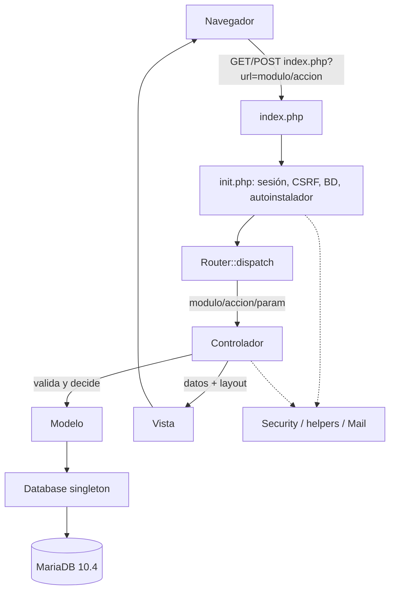

# Manual de Defensa Técnica — JV3000 C.A.

Documento de estudio para explicar y defender el sistema ante un jurado académico. No es un
manual de usuario ni una copia del código: es el mapa de **qué hace cada pieza, por qué está
así y qué se sacrificó al elegirla**.

**Cómo usarlo**

1. Empieza por el capítulo 0 (arquitectura) y el 1 (inventario): son el mapa mental.
2. Para una función concreta, busca su nombre con `Ctrl+F`; cada ficha tiene firma, parámetros,
   paso a paso, retorno, importancia y decisión de diseño.
3. Las 10 decisiones del capítulo 9 son las preguntas más probables del jurado.
4. El capítulo 11 trae 20 preguntas con respuesta breve para ensayar.

**Convenciones**

- La firma está copiada del código real (tipos, valores por defecto y visibilidad incluidos).
- `private`/`protected` se marcan como **interno**: no se llama desde fuera de la clase.
- «Trade-off» significa siempre lo mismo: qué se gana y qué se pierde con la decisión.
- Los conteos de métodos se verificaron con Reflection sobre el código, no a ojo.

---

## Índice

- [0. Arquitectura en una página](#0-arquitectura-en-una-página)
- [1. Mapa de archivos (inventario)](#1-mapa-de-archivos-inventario)
- [2. Núcleo MVC: Controller, Model y Router](#2-núcleo-mvc-controller-model-y-router)
- [3. Infraestructura: Security, Database y Mail](#3-infraestructura-security-database-y-mail)
- [4. Controladores](#4-controladores)
- [5. Modelos](#5-modelos)
- [6. Vistas](#6-vistas)
- [7. Flujos críticos de extremo a extremo](#7-flujos-críticos-de-extremo-a-extremo)
- [8. Mapa de rutas, permisos y roles](#8-mapa-de-rutas-permisos-y-roles)
- [9. Decisiones de arquitectura y alternativas descartadas](#9-decisiones-de-arquitectura-y-alternativas-descartadas)
- [10. Glosario](#10-glosario)
- [11. Banco de preguntas para el jurado](#11-banco-de-preguntas-para-el-jurado)
- [Anexo. Verificación y mantenimiento del manual](#anexo-verificación-y-mantenimiento-del-manual)

---

## 0. Arquitectura en una página

JV3000 es una aplicación **MVC artesanal** sin framework: una sola puerta de entrada
(`index.php`), un enrutador que traduce la URL en controlador y acción, controladores que
orquestan, modelos que hablan con MariaDB y vistas que solo pintan. La seguridad, la conexión
y los helpers son transversales.

**Recorrido de una petición**

1. Apache reescribe la URL a `index.php?url=...` (`.htaccess`).
2. `index.php` registra el autoload de `core/` y `models/`, carga `init.php` y entrega la URL al Router.
3. `init.php` arranca la sesión, valida la sesión y el CSRF, conecta la base y activa el autoinstalador.
4. `Router::dispatch()` convierte `compras/detalle` en `ComprasController::detalle()`.
5. El controlador valida entrada, llama al modelo y responde con `view()`, `json()` o `redirect()`.
6. `Controller::view()` inyecta la tasa BCV, versiona los assets y envuelve la vista en el layout.

**Tres ideas que sostienen el diseño**

- **Una responsabilidad por capa:** el controlador no escribe SQL y la vista no decide permisos.
- **El servidor no confía en el navegador:** precios, stock, roles y CSRF se revalidan siempre.
- **Fallo contenido:** el Router captura cualquier `Throwable` de una acción y responde sin tumbar la aplicación.

---

## 1. Mapa de archivos (inventario)

### 1.1 Raíz y núcleo

| Archivo | Ruta | Rol en la arquitectura | Problema que resuelve |
|---|---|---|---|
| `index.php` | raíz | Front controller | Punto único de entrada: autoload, bootstrap y despacho de la URL. |
| `init.php` | raíz | Bootstrap transversal | Sesión, seguridad, conexión, autoinstalador y manejador global de errores en un solo lugar. |
| `.htaccess` | raíz | Reescritura Apache | Convierte rutas limpias en `index.php?url=...` sin exponer la estructura interna. |
| `Controller.php` | `core/` | Clase base de controladores | Render, JSON, redirección, flash, lectura segura de POST y límite de errores. |
| `Model.php` | `core/` | Clase base de modelos | Entrega la conexión única a todo modelo sin repetir el `new Database`. |
| `Router.php` | `core/` | Enrutador | Traduce URL a controlador/acción, resuelve 404 y contiene excepciones. |

### 1.2 Controladores (14 archivos, 43 métodos)

| Archivo | Ruta | Rol | Problema que resuelve |
|---|---|---|---|
| `ComprasController.php` | `controllers/` | Compras y recepción | Tablero, alta de factura, pagos, anulación, tasa manual y solicitudes. |
| `DashboardController.php` | `controllers/` | Panel de inicio | KPIs, alertas y actividad reciente del día. |
| `DiagnosticoController.php` | `controllers/` | Errores internos | Recibe reportes del navegador; la interfaz está deshabilitada a propósito. |
| `EstadisticasController.php` | `controllers/` | Analítica | Página y endpoints AJAX de ventas, margen, inventario y proveedores. |
| `HistorialController.php` | `controllers/` | Auditoría de operaciones | Lista compras y ventas según el alcance del rol. |
| `NotaEntregaController.php` | `controllers/` | Documento imprimible | Guarda el preview de la venta y renderiza la nota por token o por id. |
| `PerfilController.php` | `controllers/` | Cuenta propia | Edición de datos y contraseña del usuario logueado. |
| `ProductosController.php` | `controllers/` | Inventario | Listado, edición y descarte de productos para la alarma de stock. |
| `ReporteInventarioController.php` | `controllers/` | Reporte imprimible | Valorización del inventario activo. |
| `SalidasController.php` | `controllers/` | Ventas | Formulario, preview y confirmación transaccional de la venta. |
| `SolicitudesController.php` | `controllers/` | Reposición | Crear y cancelar solicitudes desde Ventas cuando falta stock. |
| `TasasController.php` | `controllers/` | Divisas | Tasas BCV USD/EUR con caché y consulta paralela. |
| `UsuariosController.php` | `controllers/` | Colaboradores | Alta, edición, aprobación y suspensión de cuentas. |

### 1.3 Modelos (15 archivos, 135 métodos)

| Archivo | Ruta | Rol | Problema que resuelve |
|---|---|---|---|
| `Auditoria.php` | `models/` | Historial unificado | Consulta compras y ventas con filtros y permisos. |
| `Categoria.php` | `models/` | Árbol de categorías | Alta/edición, jerarquía de dos niveles y estado por stock. |
| `Cliente.php` | `models/` | Clientes | CRUD, unicidad de documento y activación. |
| `Compra.php` | `models/` | Compras | Registro con reserva de stock del proveedor, anulación y pago. |
| `ErrorLog.php` | `models/` | Observabilidad | Agrupa errores por huella, evita duplicados y avisa por correo. |
| `Estadistica.php` | `models/` | Analítica | KPIs, series, rentabilidad, rotación y vencimientos. |
| `NotaEntrega.php` | `models/` | Documento de venta | Valida el preview y arma los totales de la nota. |
| `PagoCompra.php` | `models/` | Pagos | Abonos, saldo pendiente y total pagado. |
| `Producto.php` | `models/` | Inventario | Edición validada, baja por vencimiento y estado por stock. |
| `Proveedor.php` | `models/` | Proveedores | CRUD, catálogo de costos y disponibilidad. |
| `Recepcion.php` | `models/` | Recepción | Entrada de mercancía idempotente con costo promedio y lotes. |
| `ReporteInventario.php` | `models/` | Reporte | Valorización a costo del inventario activo. |
| `Salida.php` | `models/` | Ventas | Confirmación con FEFO, precios de BD y anulación. |
| `Solicitud.php` | `models/` | Reposición | Solicitudes pendientes, historial y cancelación. |
| `Usuario.php` | `models/` | Cuentas | Alta, edición, contraseñas, aprobación y perfil. |

### 1.4 Includes (infraestructura y soporte)

| Archivo | Ruta | Rol | Problema que resuelve |
|---|---|---|---|
| `config.php` | `includes/` | Configuración | Carga constantes y `.env` sin dispersar credenciales. |
| `Database.php` | `includes/` | Acceso a datos | Singleton `mysqli` con consultas preparadas y transacciones. |
| `Security.php` | `includes/` | Seguridad | Sesión, CSRF, escape, roles y guardas por permiso. |
| `helpers.php` | `includes/` | Utilidades (54 funciones) | Formatos, validaciones, lotes, tasas, auditoría y alertas. |
| `Mail.php` | `includes/` | Correo | Envío SMTP con TLS y detección de conectividad. |
| `diseno.php` | `includes/` | Head global | Metadatos, CSS/JS comunes, CSRF y configuración JS. |
| `sidebar.php` | `includes/` | Navegación | Menú ordenado por fases y filtrado por rol. |
| `EstadoInstalacion.php` | `includes/` | Autoinstalador | Detecta si la base existe y está al día. |
| `InstaladorInicial.php` | `includes/` | Autoinstalador | Importa el esquema inicial en una instalación limpia. |
| `SchemaCompatibility.php` | `includes/` | Autoinstalador | Aplica cambios de esquema compatibles entre versiones. |
| `StartupDiagnostics.php` | `includes/` | Autoinstalador | Diagnostica y explica fallos de arranque. |
| `alertas_ajax.php` | `includes/ajax/` | Endpoint | Alertas de stock para la campana del panel. |
| `clientes_buscar.php` | `includes/ajax/` | Endpoint | Búsqueda de clientes para Ventas (solo rol con venta). |
| `exportar_csv.php` | `includes/ajax/` | Endpoint | Exportación del historial según el mapa de roles. |
| `productos_buscar.php` | `includes/ajax/` | Endpoint | Búsqueda de productos con stock para Ventas. |

### 1.5 Vistas (14 archivos)

| Archivo | Ruta | Qué pinta |
|---|---|---|
| `main.php` | `views/layouts/` | Layout común: head, sidebar, flash, contenido y cierre. |
| `index.php` | `views/dashboard/` | Panel: KPIs, alertas, actividad y accesos. |
| `_campana_alertas.php` | `views/dashboard/` | Parcial compartido de la campana de alertas. |
| `index.php` | `views/compras/` | Tablero de compras, carrito, pagos, recepción y catálogo. |
| `index.php` | `views/productos/` | Inventario, filtros y modales de edición/descarte. |
| `index.php` | `views/salidas/` | Ventas, clientes, carrito y nota de entrega. |
| `index.php` | `views/estadisticas/` | Filtros, KPIs, gráficos y tablas analíticas. |
| `index.php` | `views/historial/` | Historial de operaciones y detalle. |
| `index.php` | `views/usuarios/` | Colaboradores: alta, edición, roles y estado. |
| `index.php` | `views/perfil/` | Datos y contraseña del usuario. |
| `index.php` | `views/reporte_inventario/` | Reporte imprimible valorizado. |
| `nota.php` | `views/nota_entrega/` | Nota de entrega imprimible. |
| `error.php` | `views/nota_entrega/` | Error amable cuando la nota no existe o no es válida. |
| `index.php` | `views/diagnostico/` | Panel interno de errores (deshabilitado). |

**Fuera de `views/`:** `dashboard/index.php` es el panel raíz que se sirve tras el login;
`login/` contiene el acceso y la recuperación; `assets/` guarda CSS/JS por módulo;
`db/jv3000_portable_v6.sql` es el seed de instalación limpia; `tests/` y `tools/` son la red
de seguridad del proyecto.

> **Nota de conteo.** El inventario real da **226 métodos** en `core/`, `controllers/`,
> `models/` e `includes/Security|Database|Mail`. El conteo previo de 224 omitía
> `Database::__construct` (privado, descrito en su clase) y `Salida::mapaTiposGrupo`.
> El manual documenta los 226 para que no falte ninguna firma verificable.

---

## 2. Núcleo MVC: Controller, Model y Router

### 2.1 `core/Controller.php` — 12 métodos

Clase base de todos los controladores. Resuelve lo que ningún módulo debería repetir: render,
JSON, redirección, mensajes flash, lectura segura de entrada y respuesta única ante errores.

#### `versionarAssets()`
`protected function versionarAssets(array $data): array`

- **Parámetros:** `$data`, arreglo de datos de la vista que puede traer `css` y `js`.
- **Paso a paso:** recorre cada hoja de estilo y script; obtiene la fecha de modificación del archivo; añade `?v=<mtime>` a la URL.
- **Devuelve:** el mismo arreglo con las rutas ya versionadas.
- **Por qué importa:** evita que el navegador sirva CSS/JS viejos después de un cambio, sin renombrar archivos.
- **Decisión de diseño:** se descartó un manifiesto de build con hash. Se eligió `mtime` porque no hay pipeline de compilación; consecuencia: cualquier toque al archivo invalida caché. **Trade-off:** gana simplicidad y cero configuración; pierde caché inmutable a largo plazo.

#### `view()`
`protected function view(string $view, array $data = []): void`

- **Parámetros:** `$view` (ruta lógica, p. ej. `compras/index`), `$data` (variables para la vista).
- **Paso a paso:** inyecta la tasa BCV; versiona assets; convierte `$data` en variables; captura la vista con `ob_start()`; carga `views/layouts/main.php` con el contenido capturado.
- **Devuelve:** nada; imprime la respuesta HTML.
- **Por qué importa:** es el contrato de render: toda página comparte layout, flash y assets versionados.
- **Decisión de diseño:** se descartó que cada vista imprima su propio HTML completo. Se centralizó el layout para no duplicar `head`, sidebar y cierre; consecuencia: las vistas dependen del layout. **Trade-off:** gana consistencia y menos duplicación; pierde libertad para páginas con estructura radicalmente distinta (para eso existe `renderRaw`).

#### `renderRaw()`
`protected function renderRaw(string $view, array $data = []): void`

- **Parámetros:** `$view`, `$data`.
- **Paso a paso:** inyecta la tasa y versiona assets, pero incluye la vista sin layout.
- **Devuelve:** nada; imprime HTML.
- **Por qué importa:** permite documentos imprimibles (nota de entrega, reporte) que no deben llevar sidebar ni navegación.
- **Decisión de diseño:** se descartó un parámetro `$layout = false` en `view()`. Un método separado expresa mejor la intención; consecuencia: comparte la preparación de datos con `view()`. **Trade-off:** gana claridad semántica; pierde una pequeña duplicación de tres líneas.

#### `json()`
`protected function json(array $data, int $status = 200): void`

- **Parámetros:** `$data` (respuesta), `$status` (código HTTP).
- **Paso a paso:** fija `Content-Type: application/json`; añade `tasa_bcv`; codifica; imprime; termina con `exit`.
- **Devuelve:** nada; cierra la petición.
- **Por qué importa:** todos los endpoints AJAX responden con la misma forma y la misma tasa de cambio.
- **Decisión de diseño:** se descartó devolver el JSON y dejar que el llamador imprima. El `exit` impide que un `echo` posterior contamine el JSON; consecuencia: no se puede envolver en tests unitarios sin capturar la salida. **Trade-off:** gana robustez en producción; pierde testabilidad directa.

#### `inyectarTasaBcv()`
`private function inyectarTasaBcv(array $data): array`

- **Parámetros:** `$data`.
- **Paso a paso:** obtiene la tasa con `jv_tasa_bcv()`; agrega `tasa_bcv`, `tasa_bcv_fecha` y `js_config.tasaBcv`.
- **Devuelve:** el arreglo enriquecido.
- **Por qué importa:** PHP y JavaScript convierten USD→Bs con la misma fuente, sin duplicar la lógica de caché.
- **Decisión de diseño:** se descartó consultar la tasa en cada controlador. Se centralizó en la clase base; consecuencia: toda vista recibe la tasa aunque no la use. **Trade-off:** gana coherencia; pierde un poco de trabajo por petición (mitigado por caché de 30 min).

#### `redirect()`
`protected function redirect(string $route = '', array $query = []): void`

- **Parámetros:** `$route` (ruta MVC), `$query` (parámetros adicionales).
- **Paso a paso:** arma `APP_URL_BASE . 'index.php?url=' . $route`; añade la query con `http_build_query`; envía `Location`; termina.
- **Devuelve:** nada.
- **Por qué importa:** el sistema funciona igual en la raíz o en un subdirectorio de XAMPP.
- **Decisión de diseño:** se descartaron rutas absolutas escritas a mano. Se construyen desde una constante; consecuencia: todo depende de `APP_URL_BASE` bien configurada. **Trade-off:** gana portabilidad; pierde la posibilidad de enlaces externos sin pasar por el helper.

#### `flash()`
`protected function flash(string $tipo, string $texto, ?string $origen = null): void`

- **Parámetros:** `$tipo` (`success`, `error`, etc.), `$texto`, `$origen` (identificador para reabrir el modal correcto).
- **Paso a paso:** guarda en sesión un arreglo con tipo, texto y origen; el layout lo consume en la siguiente carga.
- **Devuelve:** nada.
- **Por qué importa:** el patrón POST→redirect→GET evita reenvíos y permite mostrar el resultado sin ensuciar la URL.
- **Decisión de diseño:** se descartaron mensajes por query string. La sesión permite texto largo y el `origen` permite que el JS reabra el modal; consecuencia: depende de que la sesión esté viva. **Trade-off:** gana UX y privacidad del mensaje; pierde persistencia si el usuario abre otra pestaña antes de consumirlo.

#### `consumeFlash()`
`protected function consumeFlash(): ?array`

- **Parámetros:** ninguno.
- **Paso a paso:** lee el flash de sesión, lo elimina y lo devuelve.
- **Devuelve:** el arreglo del flash o `null`.
- **Por qué importa:** garantiza que un mensaje se muestre una sola vez.
- **Decisión de diseño:** se descartó borrarlo en la vista. La clase base controla el ciclo completo; consecuencia: la vista no puede leer dos veces el mismo flash. **Trade-off:** gana unicidad; pierde flexibilidad para mensajes persistentes.

#### `postTexto()`
`protected function postTexto(string $nombre, int $max = 255): ?string`

- **Parámetros:** `$nombre` (clave POST), `$max` (longitud máxima).
- **Paso a paso:** rechaza arreglos u objetos; recorta espacios; devuelve `null` si no existe o queda vacío; limita a `$max`.
- **Devuelve:** `string` o `null`.
- **Por qué importa:** evita que un `name[]` malicioso llegue a una consulta o a una función que espera texto.
- **Decisión de diseño:** se descartó leer `$_POST` directamente en cada controlador. Se centraliza la validación de tipo; consecuencia: los campos opcionales deben tratarse como `null`. **Trade-off:** gana seguridad y uniformidad; pierde la comodidad de acceder al valor crudo.

#### `postInt()`
`protected function postInt(string $nombre, int $min = PHP_INT_MIN, int $max = PHP_INT_MAX): ?int`

- **Parámetros:** `$nombre`, `$min`, `$max`.
- **Paso a paso:** rechaza arreglos; valida con `filter_var` entero; comprueba rango; devuelve `null` si no cumple.
- **Devuelve:** `int` o `null`.
- **Por qué importa:** un id, una cantidad o un rol nunca llegan como texto arbitrario al modelo.
- **Decisión de diseño:** se descartó `(int)` porque convierte `"12abc"` en `12` silenciosamente. Se exige un entero estricto; consecuencia: entradas con espacios o formato raro se rechazan. **Trade-off:** gana integridad; pierde tolerancia a formatos informales.

#### `postFloat()`
`protected function postFloat(string $nombre, float $min = -1.0e15, float $max = 1.0e15): ?float`

- **Parámetros:** `$nombre`, `$min`, `$max`.
- **Paso a paso:** rechaza arreglos; valida decimal finito; comprueba rango; devuelve `null` si no cumple.
- **Devuelve:** `float` o `null`.
- **Por qué importa:** protege montos y tasas de `INF`, `NAN` y de la coma decimal mal interpretada.
- **Decisión de diseño:** se descartó `floatval()` directo. Se exige número finito y rango; consecuencia: el cliente debe enviar punto decimal. **Trade-off:** gana precisión; pierde aceptar formatos locales sin normalizar.

#### `responderError()`
`public function responderError(Throwable $e): never`

- **Parámetros:** `$e`, la excepción o error capturado por el Router.
- **Paso a paso:** revierte la transacción si sigue abierta; registra en `error_log`; guarda en `ErrorLog` (sin romper si falla); si la petición es AJAX responde JSON 500; si no, guarda un flash y redirige al referer del mismo host o al dashboard.
- **Devuelve:** nunca retorna; termina la petición.
- **Por qué importa:** un módulo roto no deja al usuario en una pantalla blanca ni pierde la transacción a medias.
- **Decisión de diseño:** se descartó dejar que el error fatal de PHP termine la petición. Se captura por acción y se responde en contexto; consecuencia: el usuario ve un mensaje genérico y el detalle queda en el log. **Trade-off:** gana continuidad y trazabilidad; pierde mostrar la causa exacta en pantalla (a propósito).

### 2.2 `core/Model.php` — 1 método

#### `__construct()`
`public function __construct()`

- **Parámetros:** ninguno.
- **Paso a paso:** asigna a `$this->db` la instancia única de `Database`.
- **Devuelve:** nada.
- **Por qué importa:** cualquier modelo puede consultar sin abrir conexiones ni recibir la BD por parámetro.
- **Decisión de diseño:** se descartó inyectar la conexión desde el controlador. El singleton evita múltiples conexiones por petición; consecuencia: el modelo queda acoplado a una conexión global. **Trade-off:** gana simplicidad y rendimiento; pierde facilidad para sustituir la BD en pruebas unitarias.

### 2.3 `core/Router.php` — 4 métodos

#### `dispatch()`
`public static function dispatch(string $url): void`

- **Parámetros:** `$url`, la ruta solicitada (`modulo/accion/param...`).
- **Paso a paso:** carga las clases base; normaliza la URL; si está vacía usa `dashboard`; convierte el módulo a CamelCase y le añade `Controller`; verifica archivo, clase y método; llama a la acción con los parámetros restantes dentro de `try/catch`; si algo falta, responde 404; si algo falla, delega en `responderError`.
- **Devuelve:** nada; ejecuta la acción.
- **Por qué importa:** es el único punto que decide qué código se ejecuta; también es la red de seguridad de toda la aplicación.
- **Decisión de diseño:** se descartó una tabla de rutas declarativa. La convención `modulo/accion` evita configuración y refleja la estructura de carpetas; consecuencia: renombrar una clase cambia la URL pública. **Trade-off:** gana cero configuración y previsibilidad; pierde rutas bonitas y desacopladas del nombre de clase.

#### `camelize()`
`private static function camelize(string $segment): string`

- **Parámetros:** `$segment`, un fragmento de URL (`nota_entrega`, `reporte-inventario`).
- **Paso a paso:** separa por guiones y guiones bajos; capitaliza cada palabra; las une sin separadores.
- **Devuelve:** el nombre en CamelCase (`NotaEntrega`).
- **Por qué importa:** permite URLs legibles sin obligar a escribir mayúsculas en el navegador.
- **Decisión de diseño:** se descartó un mapa manual URL→clase. La transformación automática cubre todos los módulos; consecuencia: no admite nombres con caracteres no ASCII. **Trade-off:** gana comodidad; pierde flexibilidad para alias.

#### `loadBase()`
`private static function loadBase(): void`

- **Parámetros:** ninguno.
- **Paso a paso:** incluye una sola vez `Controller.php` y `Model.php`.
- **Devuelve:** nada.
- **Por qué importa:** el Router puede instanciar el controlador aunque el autoload no haya corrido todavía.
- **Decisión de diseño:** se descartó cargar todas las clases al inicio. La carga perezosa solo trae lo necesario; consecuencia: hay dos mecanismos de carga (autoload y `loadBase`) que deben convivir. **Trade-off:** gana arranque ligero; pierde un único punto de carga.

#### `notFound()`
`private static function notFound(string $msg): void`

- **Parámetros:** `$msg`, mensaje para el usuario.
- **Paso a paso:** responde con código 404 y un mensaje; termina la petición.
- **Devuelve:** nada.
- **Por qué importa:** distingue «no existe» de «falló» y evita que un módulo inexistente caiga en el dashboard silenciosamente.
- **Decisión de diseño:** se descartó redirigir siempre al panel. El 404 es semánticamente correcto y facilita el diagnóstico; consecuencia: el usuario ve una pantalla de error. **Trade-off:** gana claridad técnica; pierde una salida «elegante» automática.

---

## 3. Infraestructura: Security, Database y Mail

### 3.1 `includes/Security.php` — 14 métodos

Guarda transversal de sesión, CSRF y roles. Se invoca desde `init.php` y desde cada
controlador; ninguna vista decide permisos por su cuenta.

#### `validateSession()`
`public static function validateSession(): void`

- **Parámetros:** ninguno.
- **Paso a paso:** comprueba que exista usuario en sesión; compara la IP registrada al iniciar; verifica la marca de última actividad; si algo falla, destruye la sesión y redirige al login con el motivo.
- **Devuelve:** nada; corta la petición si la sesión no es válida.
- **Por qué importa:** impide reutilizar una sesión robada desde otra máquina o dejarla abierta indefinidamente.
- **Decisión de diseño:** se descartó validar solo el `PHPSESSID`. Se añadió huella por IP y caducidad; consecuencia: un cambio de red (móvil) puede expulsar al usuario. **Trade-off:** gana protección contra secuestro de sesión; pierde tolerancia a IP dinámica.

#### `sanitizeGlobals()`
`public static function sanitizeGlobals(): void`

- **Parámetros:** ninguno.
- **Paso a paso:** recorre `$_GET`, `$_POST` y `$_COOKIE`; normaliza cadenas y elimina etiquetas o bytes de control peligrosos.
- **Devuelve:** nada; modifica los superglobales.
- **Por qué importa:** añade una capa de defensa antes de que cualquier controlador lea la entrada.
- **Decisión de diseño:** se descartó confiar solo en el escape al imprimir. Se sanea la entrada y además se escapa la salida; consecuencia: puede alterar texto legítimo con símbolos. **Trade-off:** gana defensa en profundidad; pierde fidelidad absoluta del dato original.

#### `generateToken()`
`public static function generateToken(): string`

- **Parámetros:** ninguno.
- **Paso a paso:** si no hay token en sesión, genera 32 bytes aleatorios y los guarda en hexadecimal; devuelve el existente si ya estaba.
- **Devuelve:** el token CSRF de la sesión.
- **Por qué importa:** es la base de la protección contra peticiones falsificadas.
- **Decisión de diseño:** se descartó un token por formulario. Uno por sesión simplifica las vistas y el JS; consecuencia: no hay rotación por envío. **Trade-off:** gana simplicidad; pierde granularidad ante un token filtrado.

#### `validateCSRF()`
`public static function validateCSRF(): void`

- **Parámetros:** ninguno; lee `$_POST['csrf_token']`.
- **Paso a paso:** comprueba que el token exista; compara con el de sesión usando `hash_equals`; si no coincide, delega en `failCSRF`.
- **Devuelve:** nada; aborta si es inválido.
- **Por qué importa:** ninguna escritura se ejecuta sin demostrar que el formulario salió de la aplicación.
- **Decisión de diseño:** se descartó comparar con `===`. `hash_equals` evita filtrar información por tiempo de comparación; consecuencia: todo POST debe incluir el campo. **Trade-off:** gana seguridad; pierde la posibilidad de endpoints POST sin formulario.

#### `failCSRF()`
`private static function failCSRF(): void`

- **Parámetros:** ninguno.
- **Paso a paso:** responde 403, registra el intento y termina la petición.
- **Devuelve:** nada.
- **Por qué importa:** falla cerrado y deja rastro de un posible ataque.
- **Decisión de diseño:** se descartó redirigir al login. Un 403 explícito distingue «no autorizado» de «sesión vencida»; consecuencia: el atacante sabe que el endpoint existe. **Trade-off:** gana claridad operativa; pierde ocultamiento.

#### `escape()`
`public static function escape(string $value): string`

- **Parámetros:** `$value`, texto a imprimir.
- **Paso a paso:** aplica `htmlspecialchars` con `ENT_QUOTES` y UTF-8.
- **Devuelve:** el texto seguro para HTML.
- **Por qué importa:** neutraliza XSS en nombres, observaciones y cualquier dato de usuario.
- **Decisión de diseño:** se descartó `strip_tags` como única defensa. Escapar conserva el dato y evita interpretación; consecuencia: hay que escapar en cada punto de salida. **Trade-off:** gana integridad del dato; pierde automatismo.

#### `esAdmin()`
`public static function esAdmin(): bool`

- **Parámetros:** ninguno.
- **Paso a paso:** comprueba que `$_SESSION['id_rol']` sea exactamente 1.
- **Devuelve:** `true` si es administrador.
- **Por qué importa:** es la guarda más usada para operaciones destructivas o de configuración.
- **Decisión de diseño:** se descartó una tabla de permisos por acción. Con tres roles fijos, una comparación es suficiente; consecuencia: el mapa de permisos vive en código. **Trade-off:** gana claridad; pierde flexibilidad para permisos granulares.

#### `soloAdmin()`
`public static function soloAdmin(): void`

- **Parámetros:** ninguno.
- **Paso a paso:** si `esAdmin()` es falso, responde 403 o redirige al dashboard.
- **Devuelve:** nada; corta la petición.
- **Por qué importa:** evita repetir la misma condición en cada acción administrativa.
- **Decisión de diseño:** se descartó un middleware global por ruta. La llamada explícita deja visible el permiso en el controlador; consecuencia: olvidarla es posible y por eso se prueba. **Trade-off:** gana legibilidad; pierde garantía automática.

#### `puedeCargar()`
`public static function puedeCargar(): bool`

- **Parámetros:** ninguno.
- **Paso a paso:** devuelve `true` para rol 1 (admin) o 2 (carga).
- **Devuelve:** booleano.
- **Por qué importa:** define quién puede comprar, recibir y mantener catálogos.
- **Decisión de diseño:** se descartó consultar la BD en cada verificación. El rol vive en sesión; consecuencia: un cambio de rol exige renovar sesión. **Trade-off:** gana velocidad; pierde actualización inmediata.

#### `puedeVender()`
`public static function puedeVender(): bool`

- **Parámetros:** ninguno.
- **Paso a paso:** devuelve `true` para rol 1 o 3 (ventas).
- **Devuelve:** booleano.
- **Por qué importa:** separa la operación de venta de la de carga, incluso para el admin.
- **Decisión de diseño:** se descartaron roles combinados. La separación evita que un operador de carga venda por error; consecuencia: el admin ve ambos módulos. **Trade-off:** gana control operativo; pierde polivalencia de cuentas.

#### `verificarPermisoCarga()`
`public static function verificarPermisoCarga(): void`

- **Parámetros:** ninguno.
- **Paso a paso:** si no `puedeCargar()`, responde 403 o redirige.
- **Devuelve:** nada.
- **Por qué importa:** protege Compras, Recepción, Categorías y Proveedores en el servidor, no solo en el menú.
- **Decisión de diseño:** se descartó confiar en ocultar el enlace del sidebar. La comprobación server-side es obligatoria; consecuencia: cada acción de carga debe invocarla. **Trade-off:** gana seguridad real; pierde comodidad.

#### `verificarPermisoVenta()`
`public static function verificarPermisoVenta(): void`

- **Parámetros:** ninguno.
- **Paso a paso:** si no `puedeVender()`, responde 403 o redirige.
- **Devuelve:** nada.
- **Por qué importa:** impide que un operador de carga confirme ventas o consulte datos sensibles de ventas.
- **Decisión de diseño:** se descartó un permiso único «operador». La venta tiene reglas propias (stock, precios, clientes); consecuencia: hay dos guardas distintas. **Trade-off:** gana precisión; pierde simplicidad.

#### `currentUser()`
`public static function currentUser(): array`

- **Parámetros:** ninguno.
- **Paso a paso:** devuelve los datos del usuario guardados en sesión (id, nombre, rol).
- **Devuelve:** arreglo con la identidad activa.
- **Por qué importa:** los controladores y la auditoría necesitan saber quién ejecuta la acción sin consultar la BD.
- **Decisión de diseño:** se descartó leer el usuario de la BD en cada petición. La sesión es la fuente; consecuencia: si el nombre cambia, la sesión mantiene el anterior hasta el próximo login. **Trade-off:** gana rendimiento; pierde frescura del dato.

#### `redirectToLogin()`
`private static function redirectToLogin(string $error = ''): void`

- **Parámetros:** `$error`, motivo opcional para mostrar en el login.
- **Paso a paso:** guarda el motivo, destruye la sesión y redirige al login.
- **Devuelve:** nada.
- **Por qué importa:** cierra el ciclo de una sesión inválida sin dejar datos a medias.
- **Decisión de diseño:** se descartó mostrar el error por URL. El flash de sesión evita exponerlo y permite texto claro; consecuencia: requiere una sesión nueva para leerlo. **Trade-off:** gana limpieza; pierde simplicidad de implementación.

### 3.2 `includes/Database.php` — 15 métodos

Envoltorio de `mysqli` con consultas preparadas, transacciones y una única conexión por
petición. Los modelos nunca ven credenciales ni construyen un `mysqli` propio.

#### `__construct()`
`private function __construct()`

- **Parámetros:** ninguno.
- **Paso a paso:** se declara privado para impedir `new Database()` desde fuera.
- **Devuelve:** nada.
- **Por qué importa:** garantiza que la conexión solo se obtenga por `getInstance()`.
- **Decisión de diseño:** se descartó un constructor público. El singleton se apoya en el constructor privado; consecuencia: no se pueden crear conexiones independientes (por ejemplo, a otra base). **Trade-off:** gana control; pierde versatilidad multi-base.

#### `getInstance()`
`public static function getInstance(): self`

- **Parámetros:** ninguno.
- **Paso a paso:** crea la instancia en el primer llamado y la reutiliza en los siguientes.
- **Devuelve:** la instancia única.
- **Por qué importa:** evita abrir una conexión por cada modelo instanciado.
- **Decisión de diseño:** se descartó inyectar la conexión por constructor. El singleton reduce consumo y código; consecuencia: el estado de conexión es global. **Trade-off:** gana rendimiento y simplicidad; pierde aislamiento entre pruebas.

#### `connect()`
`public function connect(string $host, string $user, string $pass, string $db, int $port = 3306): void`

- **Parámetros:** credenciales y puerto.
- **Paso a paso:** crea el `mysqli`; fija `utf8mb4`; configura el reporte de errores para lanzar excepciones.
- **Devuelve:** nada.
- **Por qué importa:** es el único punto que conoce las credenciales y la codificación.
- **Decisión de diseño:** se descartó conectar en el constructor. La conexión explícita permite que `init.php` decida cuándo y cómo fallar; consecuencia: hay que llamarla antes de consultar. **Trade-off:** gana control del arranque; pierde comodidad.

#### `getConnection()`
`public function getConnection(): ?mysqli`

- **Parámetros:** ninguno.
- **Paso a paso:** devuelve el enlace `mysqli` o `null` si no se ha conectado.
- **Devuelve:** `mysqli|null`.
- **Por qué importa:** permite usar funciones nativas cuando el envoltorio no alcanza.
- **Decisión de diseño:** se descartó exponer la conexión como propiedad pública. El getter mantiene el encapsulamiento; consecuencia: el código que lo usa queda acoplado a `mysqli`. **Trade-off:** gana encapsulamiento; pierde abstracción total.

#### `execute()`
`public function execute(string $sql, array $params = []): mysqli_stmt`

- **Parámetros:** `$sql` con marcadores `?`, `$params` con los valores.
- **Paso a paso:** prepara la sentencia; deduce los tipos (`i`, `d`, `s`); enlaza; ejecuta; lanza excepción si falla.
- **Devuelve:** la sentencia ejecutada.
- **Por qué importa:** es la puerta única a SQL parametrizado; evita inyección por concatenación.
- **Decisión de diseño:** se descartó interpolar valores con `real_escape_string`. Los marcadores separan código y datos; consecuencia: no se pueden parametrizar identificadores (tablas/columnas) y esos casos se resuelven con listas blancas. **Trade-off:** gana seguridad; pierde flexibilidad para SQL dinámico.

#### `fetchOne()`
`public function fetchOne(string $sql, array $params = []): ?array`

- **Parámetros:** consulta y parámetros.
- **Paso a paso:** ejecuta; obtiene el resultado; devuelve la primera fila asociativa o `null`.
- **Devuelve:** `array|null`.
- **Por qué importa:** simplifica las lecturas de un solo registro (configuración, usuario, compra).
- **Decisión de diseño:** se descartó devolver siempre un arreglo vacío. `null` distingue «no existe» de «fila vacía»; consecuencia: el llamador debe comprobarlo. **Trade-off:** gana precisión; pierde uniformidad de tipo.

#### `fetchAll()`
`public function fetchAll(string $sql, array $params = []): array`

- **Parámetros:** consulta y parámetros.
- **Paso a paso:** ejecuta y devuelve todas las filas como arreglos asociativos.
- **Devuelve:** arreglo de filas.
- **Por qué importa:** es la base de listados, reportes y estadísticas.
- **Decisión de diseño:** se descartó paginar en el envoltorio. Cada modelo decide su `LIMIT`; consecuencia: la paginación se repite en varios modelos. **Trade-off:** gana libertad de consulta; pierde reutilización.

#### `insert()`
`public function insert(string $table, array $data): int`

- **Parámetros:** tabla y mapa columna→valor.
- **Paso a paso:** construye `INSERT` con marcadores; ejecuta; devuelve el id generado.
- **Devuelve:** id autoincremental.
- **Por qué importa:** evita escribir el mismo `INSERT` en cada modelo y centraliza el escapado de identificadores.
- **Decisión de diseño:** se descartó un ORM. El constructor de SQL cubre el 90 % de los casos; consecuencia: no maneja `INSERT ... SELECT` ni cláusulas especiales. **Trade-off:** gana concisión; pierde cobertura total.

#### `update()`
`public function update(string $table, array $data, string $where, array $whereParams = []): int`

- **Parámetros:** tabla, columnas a cambiar, condición y parámetros de la condición.
- **Paso a paso:** arma `UPDATE` con marcadores; ejecuta; devuelve filas afectadas.
- **Devuelve:** número de filas afectadas.
- **Por qué importa:** el valor afectado es la señal que usan los bloqueos optimistas y las guardas de stock.
- **Decisión de diseño:** se descartó devolver solo un booleano. Saber cuántas filas cambiaron permite detectar conflictos; consecuencia: hay que interpretar `0` (sin cambios o conflicto). **Trade-off:** gana control; pierde una respuesta binaria simple.

#### `affectedRows()`
`public function affectedRows(): int`

- **Parámetros:** ninguno.
- **Paso a paso:** consulta el contador de la última sentencia.
- **Devuelve:** entero.
- **Por qué importa:** confirma que una guarda condicional realmente modificó la fila esperada.
- **Decisión de diseño:** se descartó confiar en que la consulta «no falló». Un `UPDATE` puede afectar 0 filas sin error; consecuencia: cada operación crítica debe comprobarlo. **Trade-off:** gana rigor; pierde simplicidad.

#### `begin()`
`public function begin(): void`

- **Parámetros:** ninguno.
- **Paso a paso:** desactiva el autocommit y abre una transacción.
- **Devuelve:** nada.
- **Por qué importa:** agrupa cabecera, detalle, stock y auditoría en una sola unidad atómica.
- **Decisión de diseño:** se descartó el autocommit permanente. Las operaciones críticas abren transacción explícita; consecuencia: hay que cerrarla en todos los caminos. **Trade-off:** gana integridad; pierde espontaneidad.

#### `commit()`
`public function commit(): void`

- **Parámetros:** ninguno.
- **Paso a paso:** confirma los cambios y reactiva el autocommit.
- **Devuelve:** nada.
- **Por qué importa:** marca el punto en que la operación se considera terminada.
- **Decisión de diseño:** se descartó un `save()` implícito. El commit explícito obliga a decidir cuándo termina la unidad; consecuencia: un `return` antes del commit pierde los cambios. **Trade-off:** gana claridad; pierde automatismo.

#### `rollback()`
`public function rollback(): void`

- **Parámetros:** ninguno.
- **Paso a paso:** revierte los cambios pendientes y reactiva el autocommit.
- **Devuelve:** nada.
- **Por qué importa:** deja la base intacta cuando falla una línea de la operación.
- **Decisión de diseño:** se descartó compensar con operaciones inversas. La transacción es la garantía nativa; consecuencia: el motor debe ser transaccional (InnoDB). **Trade-off:** gana atomicidad; pierde funcionamiento con tablas no transaccionales.

#### `inTransaction()`
`public function inTransaction(): bool`

- **Parámetros:** ninguno.
- **Paso a paso:** consulta el estado de transacción del enlace.
- **Devuelve:** booleano.
- **Por qué importa:** permite que el manejador de errores revierta solo si hay algo abierto.
- **Decisión de diseño:** se descartó revertir siempre. Comprobar evita errores secundarios; consecuencia: depende de que la transacción se haya abierto por `begin()`. **Trade-off:** gana seguridad; pierde independencia del driver.

#### `lastInsertId()`
`public function lastInsertId(): int`

- **Parámetros:** ninguno.
- **Paso a paso:** devuelve el id generado por el último `INSERT`.
- **Devuelve:** entero.
- **Por qué importa:** conecta la cabecera recién creada con sus detalles y movimientos.
- **Decisión de diseño:** se descartó consultar `MAX(id)` después de insertar. El id nativo es exacto incluso con concurrencia; consecuencia: solo es válido inmediatamente después del `INSERT`. **Trade-off:** gana exactitud; pierde validez diferida.

### 3.3 `includes/Mail.php` — 2 métodos

#### `hayInternet()`
`public static function hayInternet(): bool`

- **Parámetros:** ninguno.
- **Paso a paso:** intenta abrir una conexión corta al host y puerto SMTP configurados.
- **Devuelve:** `true` si el socket responde.
- **Por qué importa:** evita bloquear una operación intentando enviar correo cuando no hay red.
- **Decisión de diseño:** se descartó enviar y esperar el timeout. La comprobación previa es más barata; consecuencia: un puerto abierto no garantiza que el correo se entregue. **Trade-off:** gana velocidad; pierde certeza de entrega.

#### `enviar()`
`public static function enviar(string $para, string $asunto, string $cuerpo): array`

- **Parámetros:** destinatario, asunto y cuerpo en texto plano.
- **Paso a paso:** abre el socket; saluda con `EHLO`; negocia STARTTLS; autentica; envía `MAIL FROM`, `RCPT TO` y `DATA`; cierra con `QUIT`; devuelve el resultado.
- **Devuelve:** arreglo con `ok` y mensaje.
- **Por qué importa:** permite avisar al administrador de un error nuevo o enviar códigos de recuperación sin depender de un servicio externo.
- **Decisión de diseño:** se descartó PHPMailer/Composer para no añadir dependencias. El protocolo se implementa a mano; consecuencia: no soporta adjuntos ni HTML complejo. **Trade-off:** gana autonomía y despliegue simple; pierde funcionalidades avanzadas.

---

## 4. Controladores

Los 14 controladores comparten el mismo patrón: reciben la petición, verifican permisos y
CSRF, validan la entrada, llaman al modelo, y responden con `view()`, `json()` o `redirect()`.
No contienen SQL.

### 4.1 `ComprasController` — 6 métodos

#### `index()`
`public function index(): void`

- **Parámetros:** ninguno; lee `accion` y los campos del POST.
- **Paso a paso:** exige permiso de carga; si hay POST, valida CSRF y conmuta la acción (registrar compra, anular, pagar o recepción) delegando en `Compra`, `PagoCompra` o `Recepcion`; guarda flash y redirige; en GET reúne tablero, filtros, proveedores, catálogo, solicitudes y tasa, y renderiza `compras/index`.
- **Devuelve:** nada; HTML o redirección.
- **Por qué importa:** es la puerta única del módulo; centraliza el mapa de acciones y evita que cada formulario tenga su endpoint.
- **Decisión de diseño:** se descartó una acción pública por formulario. Un despachador mantiene el módulo cohesionado; consecuencia: `index()` es el método más largo del controlador. **Trade-off:** gana cohesión y URLs estables; pierde legibilidad frente a acciones separadas.

#### `detalle()`
`public function detalle(): void`

- **Parámetros:** ninguno; lee `id_compra` por GET.
- **Paso a paso:** valida permiso de carga; convierte el id; pide `Compra::obtenerDetalle()`; responde JSON con cabecera, ítems y tasa.
- **Devuelve:** JSON.
- **Por qué importa:** alimenta el modal de factura sin recargar el tablero.
- **Decisión de diseño:** se descartó renderizar el detalle en la misma página. El endpoint bajo demanda evita cargar cientos de líneas que quizá no se consulten; consecuencia: depende de que el JS esté activo. **Trade-off:** gana rendimiento; pierde funcionamiento sin JavaScript.

#### `factura_estado()`
`public function factura_estado(): void`

- **Parámetros:** ninguno; lee `nro_factura` e `id_proveedor` por GET.
- **Paso a paso:** valida permiso; consulta `Compra::estadoFactura()`; devuelve si existe, si es del mismo proveedor, la última y la siguiente.
- **Devuelve:** JSON.
- **Por qué importa:** detecta duplicados antes de enviar el formulario y sugiere el consecutivo.
- **Decisión de diseño:** se descartó validar solo al guardar. La comprobación temprana mejora la UX; el servidor vuelve a validar; consecuencia: dos consultas por factura. **Trade-off:** gana prevención; pierde una consulta extra.

#### `tasa_manual()`
`public function tasa_manual(): void`

- **Parámetros:** ninguno; lee la tasa y la acción del POST.
- **Paso a paso:** exige admin; si la tasa viene vacía la elimina; si no, valida decimal positivo y la guarda en configuración; invalida la caché; responde según AJAX o POST nativo.
- **Devuelve:** JSON o redirección con flash.
- **Por qué importa:** permite fijar una tasa operativa cuando la oficial no está disponible o difiere.
- **Decisión de diseño:** se descartó consultar la tasa manual desde cada vista. Se guarda en configuración y se invalida caché al cambiarla; consecuencia: la tasa manual tiene prioridad absoluta. **Trade-off:** gana control operativo; pierde actualización automática mientras esté fijada.

#### `responderTasaManual()`
`private function responderTasaManual(bool $ok, ?float $tasa, ?string $fecha, bool $manual, string $mensaje, bool $es_ajax, int $status = 200): void`

- **Parámetros:** resultado, tasa, fecha, bandera de manual, mensaje, si es AJAX y estado HTTP.
- **Paso a paso:** si es AJAX responde JSON con los datos; si no, guarda flash y redirige.
- **Devuelve:** nada.
- **Por qué importa:** unifica la respuesta de guardar y retirar la tasa sin duplicar el formato.
- **Decisión de diseño:** se descartó repetir el `json()` en cada rama. Un método privado concentra el contrato; consecuencia: añade una indirección. **Trade-off:** gana consistencia; pierde lectura lineal.

#### `cancelar_solicitud()`
`public function cancelar_solicitud(): void`

- **Parámetros:** ninguno; lee `id_solicitud`.
- **Paso a paso:** valida permiso y CSRF; llama a `Solicitud::cancelar()`; flash con el resultado; vuelve a Compras.
- **Devuelve:** nada; redirección.
- **Por qué importa:** cierra el ciclo de una solicitud de reposición que ya no se va a atender.
- **Decisión de diseño:** se descartó borrar la solicitud. Se cambia de estado para conservar historial; consecuencia: la tabla crece. **Trade-off:** gana trazabilidad; pierde limpieza.

### 4.2 `DashboardController` — 2 métodos

#### `index()`
`public function index(): void`

- **Parámetros:** ninguno.
- **Paso a paso:** obtiene los datos del panel; inyecta alertas y actividad; renderiza `dashboard/index`.
- **Devuelve:** nada; HTML.
- **Por qué importa:** es la primera pantalla tras el login y resume el estado operativo.
- **Decisión de diseño:** se descartó que el panel consulte la BD directamente. El controlador concentra las consultas; consecuencia: la vista raíz `dashboard/index.php` y esta vista comparten lógica. **Trade-off:** gana separación; pierde una única implementación.

#### `obtenerDatosDashboard()`
`private function obtenerDatosDashboard(Database $db): array`

- **Parámetros:** `$db`, conexión recibida.
- **Paso a paso:** ejecuta las consultas de KPIs, últimas ventas, productos críticos, compras y actividad reciente; devuelve un arreglo listo para la vista.
- **Devuelve:** arreglo de datos.
- **Por qué importa:** mantiene el panel en una sola consulta organizada y facilita el refresco.
- **Decisión de diseño:** se descartó crear un modelo `Dashboard`. Al ser consultas de solo lectura y de una pantalla, viven en el controlador; consecuencia: no se reutilizan en otros módulos. **Trade-off:** gana simplicidad; pierde reutilización.

### 4.3 `DiagnosticoController` — 6 métodos

#### `index()`
`public function index(): void`

- **Parámetros:** ninguno.
- **Paso a paso:** llama a `denegarAccesoDiagnostico()` y termina.
- **Devuelve:** nada; 403.
- **Por qué importa:** el panel existe para diagnóstico interno, pero está cerrado a todos los roles.
- **Decisión de diseño:** se descartó exponerlo al admin. La interfaz se retiró del sidebar y se bloquea en servidor; consecuencia: el código sigue disponible para mantenimiento. **Trade-off:** gana superficie de ataque mínima; pierde una herramienta visual.

#### `cliente()`
`public function cliente(): void`

- **Parámetros:** ninguno; lee el reporte del navegador.
- **Paso a paso:** valida CSRF y formato; registra el error con `ErrorLog::registrarCliente()`; responde JSON.
- **Devuelve:** JSON.
- **Por qué importa:** captura errores de JavaScript que de otro modo solo vería el usuario.
- **Decisión de diseño:** se descartó mostrar un SweetAlert al usuario. El reporte es silencioso y agregado; consecuencia: no interrumpe la operación. **Trade-off:** gana observabilidad; pierde feedback inmediato.

#### `detalle()`
`public function detalle(): void`

- **Parámetros:** ninguno; lee `id_error`.
- **Paso a paso:** deniega el acceso; no llega a consultar.
- **Devuelve:** nada; 403.
- **Por qué importa:** impide leer stacks y rutas internas desde el navegador.
- **Decisión de diseño:** se descartó mantener la vista de detalle para admin. La información sensible se consulta en BD/log; consecuencia: el método queda como guarda. **Trade-off:** gana confidencialidad; pierde comodidad.

#### `resolver()`
`public function resolver(): void`

- **Parámetros:** ninguno.
- **Paso a paso:** deniega el acceso; no modifica datos.
- **Devuelve:** nada; 403.
- **Por qué importa:** evita que un error se marque como resuelto sin revisión.
- **Decisión de diseño:** se descartó dejar la acción al admin; se prefiere que la resolución sea un acto técnico fuera de la interfaz. **Trade-off:** gana control; pierde agilidad.

#### `denegarAccesoDiagnostico()`
`private function denegarAccesoDiagnostico(bool $json = false): void`

- **Parámetros:** `$json`, si la petición espera JSON.
- **Paso a paso:** responde 403 en JSON o redirige al dashboard; termina.
- **Devuelve:** nada.
- **Por qué importa:** una sola guarda cubre las cuatro acciones del panel.
- **Decisión de diseño:** se descartó repetir la condición en cada método. La guarda central evita olvidos; consecuencia: todas las acciones responden igual. **Trade-off:** gana uniformidad; pierde mensajes específicos.

#### `parametroTexto()`
`private function parametroTexto(string $clave): string`

- **Parámetros:** `$clave` del GET.
- **Paso a paso:** rechaza arreglos; recorta y limita el valor.
- **Devuelve:** texto seguro.
- **Por qué importa:** evita que un parámetro malformado llegue al log o a una consulta.
- **Decisión de diseño:** se descartó `$_GET` directo. Se valida el tipo antes de usar; consecuencia: parámetros vacíos se vuelven cadena vacía. **Trade-off:** gana robustez; pierde distinción entre ausente y vacío.

### 4.4 `EstadisticasController` — 11 métodos

#### `index()`
`public function index(): void`

- **Parámetros:** ninguno.
- **Paso a paso:** exige permiso de venta; valida filtros; obtiene datos del modelo; renderiza `estadisticas/index`.
- **Devuelve:** nada; HTML.
- **Por qué importa:** entrega la página completa con filtros, KPIs y gráficos.
- **Decisión de diseño:** se descartó calcular todo en el navegador. El modelo agrega en SQL; consecuencia: la página depende de la base. **Trade-off:** gana rendimiento y consistencia; pierde funcionamiento offline.

#### `datos()`
`public function datos(): void`

- **Parámetros:** ninguno; lee filtros por GET.
- **Paso a paso:** exige AJAX y permiso; valida filtros; devuelve el mismo bloque de datos para refresco.
- **Devuelve:** JSON.
- **Por qué importa:** actualiza los widgets cada 60 s sin recargar.
- **Decisión de diseño:** se descartó recargar la página completa. El endpoint reutiliza `obtenerDatos()`; consecuencia: duplica el contrato de la vista. **Trade-off:** gana fluidez; pierde una sola fuente de render.

#### `rentabilidad()`
`public function rentabilidad(): void`

- **Parámetros:** ninguno; lee ventana, filtros y página.
- **Paso a paso:** valida; llama a `Estadistica::obtenerRentabilidad()`; devuelve filas y paginación.
- **Devuelve:** JSON.
- **Por qué importa:** permite paginar una tabla costosa sin traer todo.
- **Decisión de diseño:** se descartó cargar la tabla completa. La paginación server-side acota la consulta; consecuencia: cada página es una petición. **Trade-off:** gana rendimiento; pierde búsqueda instantánea local.

#### `inventario()`
`public function inventario(): void`

- **Parámetros:** ninguno; lee filtros y página.
- **Paso a paso:** valida; combina inventario crítico y rotación baja; devuelve JSON.
- **Devuelve:** JSON.
- **Por qué importa:** alimenta las secciones «Comprar ya» y «Rotación baja».
- **Decisión de diseño:** se descartó calcular el sugerido en el cliente. El modelo aplica la regla (2× mínimo); consecuencia: la lógica no se puede cambiar sin tocar backend. **Trade-off:** gana coherencia; pierde ajuste visual rápido.

#### `vencimientos()`
`public function vencimientos(): void`

- **Parámetros:** ninguno; lee filtros y tramo.
- **Paso a paso:** valida; consulta lotes por tramo; devuelve conteos y valor en riesgo.
- **Devuelve:** JSON.
- **Por qué importa:** anticipa pérdidas por caducidad.
- **Decisión de diseño:** se descartó calcular tramos en PHP. SQL agrupa por fechas; consecuencia: la zona horaria de la BD manda. **Trade-off:** gana eficiencia; pierde control fino de fechas.

#### `proveedores()`
`public function proveedores(): void`

- **Parámetros:** ninguno; lee ventana, filtros y página.
- **Paso a paso:** valida; obtiene el consolidado; devuelve JSON.
- **Devuelve:** JSON.
- **Por qué importa:** compara volumen comprado, margen y no rotación por proveedor.
- **Decisión de diseño:** se descartó una vista materializada. Se calcula bajo demanda; consecuencia: con muchos datos puede ser costoso. **Trade-off:** gana frescura; pierde velocidad a gran escala.

#### `productosProveedor()`
`public function productosProveedor(): void`

- **Parámetros:** ninguno; lee proveedor, ventana y filtros.
- **Paso a paso:** valida; devuelve los productos sin rotación de ese proveedor.
- **Devuelve:** JSON.
- **Por qué importa:** explica el consolidado con el detalle que permite accionar.
- **Decisión de diseño:** se descartó incluir el detalle en la respuesta principal. Se pide al expandir la fila; consecuencia: una petición por proveedor abierto. **Trade-off:** gana tamaño de respuesta; pierde una sola llamada.

#### `exigirAjaxVentas()`
`private function exigirAjaxVentas(): void`

- **Parámetros:** ninguno.
- **Paso a paso:** comprueba `X-Requested-With`, sesión y `puedeVender()`; si falla, 403 JSON.
- **Devuelve:** nada; corta la petición.
- **Por qué importa:** los seis endpoints comparten la misma puerta y no quedan abiertos a otros roles.
- **Decisión de diseño:** se descartó confiar en que el JS solo llame desde la página. La cabecera y el rol se validan en servidor; consecuencia: un cliente legítimo sin la cabecera recibe 403. **Trade-off:** gana seguridad; pierde tolerancia a integraciones externas.

#### `filtrosPeriodo()`
`private function filtrosPeriodo(): array`

- **Parámetros:** ninguno; lee periodo, desde, hasta, categoría y proveedor.
- **Paso a paso:** valida fechas ISO y pertenencia; normaliza a un arreglo de filtros.
- **Devuelve:** arreglo con periodo, rango y filtros.
- **Por qué importa:** la página y los endpoints interpretan los filtros exactamente igual.
- **Decisión de diseño:** se descartó validar en cada endpoint. Una función compartida evita divergencias; consecuencia: cualquier filtro nuevo se añade aquí. **Trade-off:** gana coherencia; pierde independencia entre endpoints.

#### `parametroGet()`
`private function parametroGet(string $nombre): string`

- **Parámetros:** `$nombre` del parámetro.
- **Paso a paso:** rechaza arreglos y devuelve texto recortado.
- **Devuelve:** cadena.
- **Por qué importa:** evita que `?periodo[]=x` rompa la validación.
- **Decisión de diseño:** se descartó `filter_input` sin comprobar tipo. La guarda explícita es más estricta; consecuencia: hay que repetir la llamada por parámetro. **Trade-off:** gana robustez; pierde brevedad.

#### `fechaValida()`
`private function fechaValida(string $fecha): ?DateTimeImmutable`

- **Parámetros:** `$fecha` en formato ISO.
- **Paso a paso:** comprueba formato y que la fecha exista realmente (rechaza 31/02); devuelve el objeto o `null`.
- **Devuelve:** `DateTimeImmutable|null`.
- **Por qué importa:** impide rangos imposibles que SQL interpretaría de forma laxa.
- **Decisión de diseño:** se descartó `strtotime`, que normaliza fechas inválidas; consecuencia: hay que construir el objeto con validación estricta. **Trade-off:** gana exactitud; pierde tolerancia a formatos alternativos.

### 4.5 `HistorialController` — 3 métodos

#### `index()`
`public function index(): void`

- **Parámetros:** ninguno; lee filtros y página.
- **Paso a paso:** determina el alcance por rol (admin: compras y ventas; carga: compras; ventas: ventas); valida filtros; pide la página a `Auditoria`; renderiza `historial/index`.
- **Devuelve:** nada; HTML.
- **Por qué importa:** es la auditoría funcional del negocio, no solo un log técnico.
- **Decisión de diseño:** se descartaron dos módulos separados. Una consulta unificada con banderas de alcance evita duplicar vistas; consecuencia: el modelo construye SQL condicional. **Trade-off:** gana una sola pantalla; pierde consultas más simples.

#### `fechaValida()`
`private function fechaValida(string $fecha): string`

- **Parámetros:** `$fecha`.
- **Paso a paso:** valida el formato y la existencia real; devuelve la fecha o cadena vacía.
- **Devuelve:** cadena.
- **Por qué importa:** los filtros de fecha no pueden alterar el rango silenciosamente.
- **Decisión de diseño:** se descartó confiar en la validación del navegador. El servidor repite el control; consecuencia: código parecido al de Estadísticas. **Trade-off:** gana seguridad; pierde DRY entre controladores.

#### `parametroTexto()`
`private function parametroTexto(string $nombre): string`

- **Parámetros:** `$nombre`.
- **Paso a paso:** rechaza arreglos y recorta.
- **Devuelve:** cadena.
- **Por qué importa:** protege los filtros de texto de entradas malformadas.
- **Decisión de diseño:** se descartó usar `$_GET` directo; consecuencia: cada filtro pasa por la misma validación. **Trade-off:** gana uniformidad; pierde espontaneidad.

### 4.6 `NotaEntregaController` — 2 métodos

#### `store()`
`public function store(): void`

- **Parámetros:** ninguno; lee el formulario de venta.
- **Paso a paso:** exige permiso de venta y CSRF; construye el preview con `NotaEntrega::construirPreview()`; guarda el preview en sesión con un token; responde JSON con la URL.
- **Devuelve:** JSON.
- **Por qué importa:** permite revisar e imprimir la nota antes de confirmar la venta, sin escribir en la BD.
- **Decisión de diseño:** se descartó guardar un borrador en tablas. La sesión evita basura y transacciones a medias; consecuencia: el preview se pierde al cerrar sesión. **Trade-off:** gana limpieza; pierde persistencia entre dispositivos.

#### `index()`
`public function index(): void`

- **Parámetros:** ninguno; lee `token` o `id`.
- **Paso a paso:** si viene token, recupera el preview de sesión; si viene id, carga la salida y sus detalles; arma la nota; renderiza sin layout; si no existe, muestra `nota_entrega/error`.
- **Devuelve:** nada; HTML imprimible.
- **Por qué importa:** es el documento que recibe el cliente y la evidencia de la venta.
- **Decisión de diseño:** se descartó generar un PDF en servidor. HTML imprimible evita dependencias y funciona con el diálogo del navegador; consecuencia: el formato depende del navegador. **Trade-off:** gana simplicidad; pierde control tipográfico absoluto.

### 4.7 `PerfilController` — 1 método

#### `index()`
`public function index(): void`

- **Parámetros:** ninguno.
- **Paso a paso:** en GET muestra los datos del usuario; en POST valida CSRF y actualiza perfil o contraseña según la acción; flash y redirección.
- **Devuelve:** nada; HTML o redirección.
- **Por qué importa:** permite que cada usuario mantenga sus datos sin pasar por el administrador.
- **Decisión de diseño:** se descartó un módulo separado para la contraseña. Una sola pantalla agrupa identidad y credenciales; consecuencia: el método tiene dos flujos. **Trade-off:** gana simplicidad de navegación; pierde separación de responsabilidades.

### 4.8 `ProductosController` — 2 métodos

#### `index()`
`public function index(): void`

- **Parámetros:** ninguno.
- **Paso a paso:** lista productos con paginación y filtro de categoría; en POST valida CSRF, permiso de admin y ejecuta edición, activación o baja por vencimiento; flash y redirección.
- **Devuelve:** nada; HTML o redirección.
- **Por qué importa:** es el único punto de escritura del inventario.
- **Decisión de diseño:** se descartó crear un endpoint por acción. El formulario nativo con POST y redirect mantiene el patrón del proyecto; consecuencia: cada acción recarga la página. **Trade-off:** gana simplicidad y robustez; pierde inmediatez.

#### `descartar()`
`public function descartar(): void`

- **Parámetros:** ninguno; lee `id_producto`.
- **Paso a paso:** exige admin, CSRF y AJAX; llama a `Producto::descartar()`; responde JSON.
- **Devuelve:** JSON.
- **Por qué importa:** permite silenciar la alarma de un producto que ya no se venderá sin borrar su historial.
- **Decisión de diseño:** se descartó eliminar el producto. El descarte es reversible por configuración y conserva ventas; consecuencia: la lista de descartados crece. **Trade-off:** gana integridad histórica; pierde limpieza visual.

### 4.9 `ReporteInventarioController` — 1 método

#### `index()`
`public function index(): void`

- **Parámetros:** ninguno.
- **Paso a paso:** obtiene productos activos valorizados; renderiza sin layout para impresión.
- **Devuelve:** nada; HTML imprimible.
- **Por qué importa:** entrega una foto del inventario a costo para auditoría o gerencia.
- **Decisión de diseño:** se descartó exportar a Excel/PDF. El navegador imprime HTML; consecuencia: no hay archivo estructurado. **Trade-off:** gana cero dependencias; pierde reutilización de datos.

### 4.10 `SalidasController` — 2 métodos

#### `index()`
`public function index(): void`

- **Parámetros:** ninguno.
- **Paso a paso:** exige permiso de venta; en POST valida CSRF y conmuta la acción (preview o confirmación) delegando en `NotaEntrega`/`Salida`; en GET reúne ventas, tipos, clientes y KPIs; renderiza `salidas/index`.
- **Devuelve:** nada; HTML o redirección.
- **Por qué importa:** concentra el flujo de venta y el acceso al gestor de clientes.
- **Decisión de diseño:** se descartó que la venta se confirmara desde el listado. El preview en sesión obliga a revisar la nota; consecuencia: dos pasos para vender. **Trade-off:** gana control y evidencia; pierde velocidad.

#### `confirm()`
`public function confirm(): void`

- **Parámetros:** ninguno; lee el preview de sesión.
- **Paso a paso:** valida permiso, CSRF y token; llama a `Salida::confirmar()`; si falla devuelve el error; si funciona limpia el preview y responde JSON con el id.
- **Devuelve:** JSON.
- **Por qué importa:** separa la revisión de la escritura y evita confirmaciones accidentales.
- **Decisión de diseño:** se descartó confirmar en el mismo POST del formulario. La confirmación explícita permite validar stock y precio justo antes de escribir; consecuencia: el preview puede quedar obsoleto y el modelo debe revalidar. **Trade-off:** gana seguridad transaccional; pierde simplicidad.

### 4.11 `SolicitudesController` — 2 métodos

#### `crear()`
`public function crear(): void`

- **Parámetros:** ninguno; lee ítems y motivo.
- **Paso a paso:** exige venta y AJAX; valida CSRF; llama a `Solicitud::crear()`; responde JSON.
- **Devuelve:** JSON.
- **Por qué importa:** convierte una venta sin stock en una solicitud accionable para Compras.
- **Decisión de diseño:** se descartó bloquear la venta sin salida. La solicitud mantiene el circuito comercial; consecuencia: requiere seguimiento en Compras. **Trade-off:** gana continuidad del negocio; pierde automatismo.

#### `cancelar()`
`public function cancelar(): void`

- **Parámetros:** ninguno; lee `id_solicitud`.
- **Paso a paso:** valida permiso y CSRF; llama a `Solicitud::cancelar()`; flash y redirección.
- **Devuelve:** nada.
- **Por qué importa:** evita solicitudes zombis que confundan al comprador.
- **Decisión de diseño:** se descartó el borrado físico; se conserva el estado para auditoría. **Trade-off:** gana trazabilidad; pierde limpieza.

### 4.12 `TasasController` — 4 métodos

#### `obtener()`
`public function obtener(): void`

- **Parámetros:** ninguno.
- **Paso a paso:** si hay tasa manual, la devuelve; si no, consulta en paralelo BCV y respaldo; arma USD/EUR; responde JSON.
- **Devuelve:** JSON.
- **Por qué importa:** alimenta la conversión de toda la interfaz.
- **Decisión de diseño:** se descartó consultar solo `dolarapi`. La página oficial del BCV es la fuente primaria y la API el respaldo; consecuencia: hay que mantener dos extractores. **Trade-off:** gana exactitud; pierde simplicidad.

#### `consultarApiParalela()`
`private function consultarApiParalela(): array`

- **Parámetros:** ninguno.
- **Paso a paso:** lanza en paralelo las consultas de USD oficial, USD de respaldo y EUR; espera con tope; devuelve las respuestas.
- **Devuelve:** arreglo de respuestas.
- **Por qué importa:** reduce el peor caso de ~20 s a ~6 s.
- **Decisión de diseño:** se descartó consultar en serie. `curl_multi` paraleliza; consecuencia: el código es más complejo y hay que cerrar los handles. **Trade-off:** gana latencia; pierde legibilidad.

#### `extraerDolarBcv()`
`private function extraerDolarBcv($respuesta): ?float`

- **Parámetros:** `$respuesta`, HTML del BCV.
- **Paso a paso:** localiza el bloque del dólar; limpia etiquetas; normaliza coma decimal; devuelve el número o `null`.
- **Devuelve:** `float|null`.
- **Por qué importa:** traduce un HTML cambiante a un valor numérico seguro.
- **Decisión de diseño:** se descartó un scraper con DOM completo. Una expresión acotada es suficiente y más liviana; consecuencia: un rediseño del BCV puede romperla. **Trade-off:** gana simplicidad; pierde robustez ante cambios de HTML.

#### `extraerPromedio()`
`private function extraerPromedio($respuesta): ?float`

- **Parámetros:** `$respuesta`, JSON de la API.
- **Paso a paso:** decodifica; busca el promedio; valida que sea numérico y positivo.
- **Devuelve:** `float|null`.
- **Por qué importa:** permite usar el respaldo sin confiar ciegamente en su formato.
- **Decisión de diseño:** se descartó `floatval()` directo; se valida positividad. **Trade-off:** gana seguridad; pierde tolerancia a respuestas raras.

### 4.13 `UsuariosController` — 1 método

#### `index()`
`public function index(): void`

- **Parámetros:** ninguno.
- **Paso a paso:** exige admin; en POST valida CSRF y conmuta alta, edición, aprobación, suspensión o reseteo de contraseña; en GET lista usuarios, roles y KPIs; renderiza `usuarios/index`.
- **Devuelve:** nada; HTML o redirección.
- **Por qué importa:** es el único punto de administración de cuentas y roles.
- **Decisión de diseño:** se descartó el borrado de cuentas; solo se suspenden. La decisión preserva la trazabilidad de la auditoría; consecuencia: la lista incluye inactivos. **Trade-off:** gana historial; pierde limpieza.

---

## 5. Modelos

Los 15 modelos son la única capa que escribe SQL. Reciben datos ya validados por el
controlador, pero **vuelven a validar lo crítico** (stock, precios, permisos de dominio)
porque el navegador no es confiable.

### 5.1 `models/Auditoria.php` — 7 métodos

#### `where()`
`private function where(array $filtros): array`

- **Parámetros:** `$filtros` (fechas, tipo, usuario, texto).
- **Paso a paso:** construye condiciones `AND` con marcadores y acumula los valores; ignora filtros vacíos.
- **Devuelve:** arreglo con la cláusula SQL y sus parámetros.
- **Por qué importa:** evita repetir la misma lógica de filtros en el conteo y en el listado.
- **Decisión de diseño:** se descartó concatenar valores; se usan marcadores. **Trade-off:** gana seguridad; pierde consultas ad hoc.

#### `totalRegistros()`
`public function totalRegistros(array $filtros): int`

- **Parámetros:** `$filtros`.
- **Paso a paso:** aplica `where()`; ejecuta `COUNT(*)`; devuelve el total.
- **Devuelve:** entero.
- **Por qué importa:** permite calcular páginas sin traer todos los registros.
- **Decisión de diseño:** se descartó contar en PHP; el motor cuenta. **Trade-off:** gana memoria; pierde una consulta extra.

#### `totalPaginas()`
`public function totalPaginas(array $filtros, int $limit): int`

- **Parámetros:** `$filtros`, `$limit`.
- **Paso a paso:** divide el total entre el tamaño de página y redondea hacia arriba; garantiza al menos 1.
- **Devuelve:** entero.
- **Por qué importa:** la vista necesita un número estable de páginas.
- **Decisión de diseño:** se descartó calcularlo en la vista; el modelo expone la regla. **Trade-off:** gana consistencia; pierde cálculo único.

#### `listar()`
`public function listar(array $filtros, int $page, int $limit): array`

- **Parámetros:** filtros, página y tamaño.
- **Paso a paso:** calcula el desplazamiento; consulta con `ORDER BY fecha DESC`; devuelve la página.
- **Devuelve:** arreglo de filas.
- **Por qué importa:** alimenta la tabla de auditoría técnica.
- **Decisión de diseño:** se descartó paginar en cliente; el `LIMIT` va en SQL. **Trade-off:** gana rendimiento; pierde filtrado instantáneo local.

#### `consultaOperaciones()`
`private function consultaOperaciones(array $filtros, bool $incluir_compras, bool $incluir_ventas): array`

- **Parámetros:** filtros y banderas de alcance por rol.
- **Paso a paso:** arma una consulta unificada de compras y ventas con `UNION`; aplica filtros y etiqueta el origen.
- **Devuelve:** SQL y parámetros.
- **Por qué importa:** una sola tabla muestra ambos tipos de operación sin duplicar pantallas.
- **Decisión de diseño:** se descartaron dos consultas y una fusión en PHP. El `UNION` conserva el orden y la paginación; consecuencia: el SQL es más complejo. **Trade-off:** gana paginación correcta; pierde simplicidad.

#### `totalOperaciones()`
`public function totalOperaciones(array $filtros, bool $incluir_compras, bool $incluir_ventas): int`

- **Parámetros:** filtros y banderas.
- **Paso a paso:** envuelve la consulta unificada en un `COUNT`; devuelve el total.
- **Devuelve:** entero.
- **Por qué importa:** la paginación del historial respeta el alcance del rol.
- **Decisión de diseño:** se descartó contar ambos orígenes por separado y sumar; el alcance ya está en el SQL. **Trade-off:** gana exactitud; pierde reutilización del conteo simple.

#### `listarOperaciones()`
`public function listarOperaciones(array $filtros, int $page, int $limit, bool $incluir_compras, bool $incluir_ventas): array`

- **Parámetros:** filtros, página, tamaño y banderas.
- **Paso a paso:** aplica `LIMIT/OFFSET` a la consulta unificada; devuelve las operaciones ordenadas por fecha.
- **Devuelve:** arreglo de operaciones.
- **Por qué importa:** es la fuente real del Historial de Operaciones.
- **Decisión de diseño:** se descartó que el controlador decidiera el SQL; el modelo encapsula el alcance. **Trade-off:** gana seguridad; pierde flexibilidad para vistas ad hoc.

### 5.2 `models/Categoria.php` — 14 métodos

#### `procesar()`
`public function procesar(array $datos): array`

- **Parámetros:** nombre, descripción, ABC, manejo, padre e id.
- **Paso a paso:** normaliza el nombre con `normalizarUsuario`; valida longitud; comprueba que el padre exista, sea raíz y esté activo; impide ser su propio padre; impide convertir en hija una categoría con hijos; verifica nombre único entre hermanos; delega en `registrar()` o `editar()`.
- **Devuelve:** `['ok'=>bool,'mensaje'=>...]`.
- **Por qué importa:** concentra todas las reglas del árbol en un solo punto.
- **Decisión de diseño:** se descartó validar en el controlador y en el JS. El modelo es la última barrera; consecuencia: el controlador duplica mensajes amables. **Trade-off:** gana integridad; pierde una sola fuente de validación.

#### `nombreDuplicado()`
`private function nombreDuplicado(string $nombre, int $id_padre, int $id_actual): bool`

- **Parámetros:** nombre, padre y id que se edita.
- **Paso a paso:** busca una categoría con el mismo nombre y padre, excluyendo la propia.
- **Devuelve:** `true` si ya existe.
- **Por qué importa:** evita dos «Bebidas» colgando del mismo nivel.
- **Decisión de diseño:** se descartó un índice único global; el nombre puede repetirse en ramas distintas. **Trade-off:** gana flexibilidad; pierde una garantía de BD (queda en código).

#### `registrar()`
`private function registrar(string $nombre, string $descripcion, string $abc, string $manejo, ?array $padre): array`

- **Parámetros:** datos normalizados y padre opcional.
- **Paso a paso:** genera el código `CAT-XXX`; calcula nivel y ruta; inserta; audita; confirma.
- **Devuelve:** resultado con id.
- **Por qué importa:** crea la categoría con su identidad y posición en el árbol.
- **Decisión de diseño:** se descartó que el usuario escriba el código. El consecutivo se genera con bloqueo; consecuencia: hay una consulta más por alta. **Trade-off:** gana unicidad; pierde edición manual del código.

#### `editar()`
`private function editar(int $id_categoria, string $nombre, string $descripcion, string $abc, string $manejo, ?array $padre): array`

- **Parámetros:** id y datos normalizados.
- **Paso a paso:** conserva el código; recalcula nivel y ruta si cambió el padre; actualiza; audita.
- **Devuelve:** resultado.
- **Por qué importa:** permite reorganizar el árbol sin romper referencias por código.
- **Decisión de diseño:** se descartó regenerar el código al mover; el código es estable. **Trade-off:** gana trazabilidad; pierde coherencia visual si el código antiguo no refleja la rama.

#### `rutaNueva()`
`private function rutaNueva(string $nombre, ?array $padre): string`

- **Parámetros:** nombre y padre.
- **Paso a paso:** si hay padre, concatena su ruta con el nombre; si no, usa el nombre como raíz; normaliza separadores.
- **Devuelve:** ruta textual.
- **Por qué importa:** permite filtrar por subárbol con `LIKE` sin recursión.
- **Decisión de diseño:** se descartó una tabla de cierres (closure table). La ruta materializada es suficiente para dos niveles; consecuencia: mover una rama exige actualizar descendientes. **Trade-off:** gana consultas simples; pierde profundidad arbitraria.

#### `fila()`
`public function fila(int $id_categoria): ?array`

- **Parámetros:** id.
- **Paso a paso:** consulta la categoría; devuelve la fila o `null`.
- **Devuelve:** `array|null`.
- **Por qué importa:** el formulario de edición necesita el registro completo.
- **Decisión de diseño:** se descartó reutilizar `listar()` y filtrar en PHP. **Trade-off:** gana eficiencia; pierde una sola consulta.

#### `toggleStatus()`
`public function toggleStatus(int $id_categoria): array`

- **Parámetros:** id.
- **Paso a paso:** comprueba que no tenga productos; invierte Activa/Inactiva; audita.
- **Devuelve:** resultado.
- **Por qué importa:** evita ocultar una categoría que todavía tiene inventario.
- **Decisión de diseño:** se descartó permitir la inactivación con productos. El bloqueo protege la venta; consecuencia: hay que reasignar primero. **Trade-off:** gana coherencia; pierde rapidez.

#### `sincronizarPorStock()`
`public function sincronizarPorStock(): void`

- **Parámetros:** ninguno.
- **Paso a paso:** recorre las categorías; deduce el estado por stock; actualiza las que cambiaron; audita.
- **Devuelve:** nada.
- **Por qué importa:** mantiene el catálogo coherente tras ventas, recepciones y bajas.
- **Decisión de diseño:** se descartó un trigger de BD. La sincronización explícita es visible y testeable; consecuencia: debe invocarse tras cada operación. **Trade-off:** gana control; pierde automaticidad.

#### `estadoPorStock()`
`private function estadoPorStock(array $fila): ?string`

- **Parámetros:** fila con stock agregado.
- **Paso a paso:** si el stock total es 0 devuelve Inactiva; si hay stock, Activa; si no aplica, `null`.
- **Devuelve:** estado o `null`.
- **Por qué importa:** define la regla «sin stock, oculta» en un solo lugar.
- **Decisión de diseño:** se descartó duplicar la regla en la vista; consecuencia: la categoría cambia sola y el usuario lo ve. **Trade-off:** gana consistencia; pierde control manual en categorías con stock.

#### `listar()`
`public function listar(): array`

- **Parámetros:** ninguno.
- **Paso a paso:** devuelve todas las categorías ordenadas por ruta y nivel.
- **Devuelve:** arreglo.
- **Por qué importa:** alimenta selects y tablas que necesitan el árbol plano.
- **Decisión de diseño:** se descartó ordenar en PHP; el `ORDER BY` usa la ruta. **Trade-off:** gana simplicidad; pierde independencia del formato de ruta.

#### `listarArbol()`
`public function listarArbol(): array`

- **Parámetros:** ninguno.
- **Paso a paso:** agrupa raíces e hijas en una estructura lista para renderizar.
- **Devuelve:** arreglo anidado.
- **Por qué importa:** el gestor de categorías necesita jerarquía, no una lista plana.
- **Decisión de diseño:** se descartó construir el árbol en la vista. **Trade-off:** gana claridad; pierde reutilización para otros formatos.

#### `repararCodigos()`
`public function repararCodigos(): void`

- **Parámetros:** ninguno.
- **Paso a paso:** detecta códigos nulos o vacíos y asigna `CAT-XXX`.
- **Devuelve:** nada.
- **Por qué importa:** rescata datos heredados sin romper la unicidad.
- **Decisión de diseño:** se descartó una migración manual única; el método es idempotente. **Trade-off:** gana mantenimiento; pierde pureza (lógica de datos en runtime).

#### `repararJerarquia()`
`public function repararJerarquia(): void`

- **Parámetros:** ninguno.
- **Paso a paso:** recalcula nivel y ruta de categorías heredadas sin jerarquía.
- **Devuelve:** nada.
- **Por qué importa:** deja operativo un árbol importado de versiones anteriores.
- **Decisión de diseño:** se descartó exigir un script externo; se ejecuta como red de seguridad. **Trade-off:** gana auto-reparación; pierde determinismo si los datos son ambiguos.

#### `siguienteCodigo()`
`private function siguienteCodigo(): string`

- **Parámetros:** ninguno.
- **Paso a paso:** lee el contador `CAT` con `FOR UPDATE`; lo incrementa; formatea a tres dígitos.
- **Devuelve:** código nuevo.
- **Por qué importa:** dos altas simultáneas no pueden recibir el mismo código.
- **Decisión de diseño:** se descartó `MAX(codigo)+1`. El contador con bloqueo evita colisiones; consecuencia: requiere transacción. **Trade-off:** gana unicidad; pierde inserciones fuera de transacción.

### 5.3 `models/Cliente.php` — 6 métodos

#### `listar()`
`public function listar(): array`

- **Parámetros:** ninguno.
- **Paso a paso:** devuelve todos los clientes ordenados por id descendente.
- **Devuelve:** arreglo.
- **Por qué importa:** alimenta el gestor de clientes.
- **Decisión de diseño:** se descartó filtrar en SQL por estado; el JS filtra en pantalla. **Trade-off:** gana una sola carga; pierde escalabilidad con miles de clientes.

#### `totalActivos()`
`public function totalActivos(): int`

- **Parámetros:** ninguno.
- **Paso a paso:** cuenta clientes con estado Activo.
- **Devuelve:** entero.
- **Por qué importa:** alimenta el KPI del módulo.
- **Decisión de diseño:** se descartó contar sobre `listar()`; se hace en SQL. **Trade-off:** gana eficiencia; pierde reutilización.

#### `toggleStatus()`
`public function toggleStatus(int $idCliente): void`

- **Parámetros:** id del cliente.
- **Paso a paso:** invierte Activo/Inactivo; audita.
- **Devuelve:** nada.
- **Por qué importa:** permite retirar un cliente sin borrar su historial de ventas.
- **Decisión de diseño:** se descartó el borrado físico por las claves foráneas; consecuencia: la lista conserva inactivos. **Trade-off:** gana integridad; pierde limpieza.

#### `procesar()`
`public function procesar(array $datos): array`

- **Parámetros:** nombre, documento, teléfono, dirección, estado y acción.
- **Paso a paso:** normaliza; valida documento único y campos; delega en `registrar()` o `editar()`; audita.
- **Devuelve:** resultado.
- **Por qué importa:** es la puerta única de escritura de clientes.
- **Decisión de diseño:** se descartó validar solo en JS; el modelo repite la unicidad. **Trade-off:** gana integridad; pierde un único mensaje.

#### `registrar()`
`private function registrar(string $nombre, string $documento, string $telefono, string $direccion, string $status): array`

- **Parámetros:** datos normalizados.
- **Paso a paso:** inserta el cliente; devuelve id y nombre.
- **Devuelve:** resultado.
- **Por qué importa:** permite el alta rápida desde Ventas.
- **Decisión de diseño:** se descartó exigir RIF validado para personas; se acepta cédula. **Trade-off:** gana operatividad; pierde uniformidad fiscal.

#### `editar()`
`private function editar(int $id, string $nombre, string $documento, string $telefono, string $direccion, string $status): array`

- **Parámetros:** id y datos.
- **Paso a paso:** actualiza; verifica que el documento no pertenezca a otro; audita.
- **Devuelve:** resultado.
- **Por qué importa:** mantiene los datos fiscales correctos para la nota de entrega.
- **Decisión de diseño:** se descartó sobrescribir sin comprobar duplicados; consecuencia: una edición puede fallar y el usuario debe corregir. **Trade-off:** gana unicidad; pierde fluidez.

### 5.4 `models/Compra.php` — 10 métodos

Gestiona la compra al proveedor: reserva de existencias del catálogo, cabecera, líneas, pagos y anulación. Es el punto donde el sistema decide *qué se compra* antes de que exista mercancía física.

#### `obtenerCompras()`
`public function obtenerCompras(int $filtro_proveedor = 0, string $filtro_pago = ''): array`
- **Parámetros:** id de proveedor (0 = todos) y estado de pago (`Pendiente`, `Pagada` o vacío).
- **Paso a paso:** arma la consulta base de compras activas, añade condiciones solo si los filtros son válidos y devuelve las filas con proveedor, total, estado de recepción y estado de pago.
- **Devuelve:** arreglo de compras ordenadas para el tablero.
- **Por qué importa:** alimenta la tabla principal y sus filtros; un filtro mal armado aquí rompe la operación diaria.
- **Decisión de diseño:** filtrar en SQL con parámetros ligados en vez de traer todo y filtrar en PHP → se descartó el filtrado en cliente porque crece con el histórico y expone datos que el rol no necesita; **Trade-off:** gana rendimiento y precisión, pierde la inmediatez de un filtro sin recarga.

#### `obtenerDetalle()`
`public function obtenerDetalle(int $id_compra): ?array`
- **Parámetros:** id de la compra.
- **Paso a paso:** verifica que la compra exista y esté `Activa`, carga la cabecera con datos del proveedor y luego sus líneas con producto, cantidad, costo y total.
- **Devuelve:** cabecera + ítems, o `null` si no existe o está anulada.
- **Por qué importa:** es la fuente del modal «Ver detalle» y de la reimpresión; nunca debe mostrar compras anuladas.
- **Decisión de diseño:** dos consultas acotadas (cabecera e ítems) en vez de un `JOIN` que duplica la cabecera → se descartó el join único para evitar filas repetidas y cálculos en la vista; **Trade-off:** gana claridad y menos datos transferidos, pierde una ida y vuelta extra a la BD.

#### `obtenerProveedores()`
`public function obtenerProveedores(): array`
- **Parámetros:** ninguno.
- **Paso a paso:** consulta los proveedores con estado `Activo` y los ordena por nombre para el selector del formulario.
- **Devuelve:** arreglo de proveedores activos.
- **Por qué importa:** impide iniciar una compra contra un proveedor deshabilitado.
- **Decisión de diseño:** excluir inactivos en el modelo y no solo en la vista → se descartó confiar en el `select` porque un POST manual podría enviar cualquier id; **Trade-off:** gana integridad, pierde la posibilidad de consultar el histórico de un proveedor inactivo desde este selector.

#### `catalogoProductosPorProveedor()`
`public function catalogoProductosPorProveedor(): array`
- **Parámetros:** ninguno.
- **Paso a paso:** lee el catálogo de costos por proveedor y calcula un estado visible por producto (`AGOTADO`, `VENCIDO`, `INACTIVO` o disponible), incluyendo productos que Ventas ya no ofrece.
- **Devuelve:** mapa `id_proveedor → productos` con costo y disponibilidad.
- **Por qué importa:** es la base del POP-UP 3; permite reponer justamente lo que está agotado, que es cuando más se necesita comprar.
- **Decisión de diseño:** incluir inactivos y agotados con estado calculado, en vez de listar solo activos → se descartó el filtro de venta porque la compra es el camino de reposición; **Trade-off:** gana operatividad, pierde un selector más corto y obliga a etiquetar el estado.

#### `kpis()`
`public function kpis(): array`
- **Parámetros:** ninguno.
- **Paso a paso:** agrega en SQL el total comprado del mes, el dinero realmente pagado del mes (desde `pagos_compra`), las compras pendientes y el conteo de proveedores activos.
- **Devuelve:** arreglo asociativo con los indicadores de cabecera.
- **Por qué importa:** «Pagado (Mes)» debe reflejar dinero cobrado, no facturas emitidas; confundirlos falsea la caja.
- **Decisión de diseño:** calcular «pagado» con `pagos_compra.monto` y no con `compras.total` → se descartó el total facturado porque incluye deuda; **Trade-off:** gana exactitud financiera, pierde que el KPI coincida visualmente con el total de la tabla.

#### `prefillSolicitud()`
`public function prefillSolicitud(int $id_solicitud): ?array`
- **Parámetros:** id de la solicitud de reposición.
- **Paso a paso:** busca la solicitud pendiente, valida que siga vigente y devuelve los ítems sugeridos con proveedor y cantidades para precargar el formulario de compra.
- **Devuelve:** datos de precarga o `null` si ya fue atendida o no existe.
- **Por qué importa:** conecta Ventas (donde se detecta el faltante) con Compras sin recapturar datos.
- **Decisión de diseño:** precargar en servidor y no aceptar los ítems desde el navegador → se descartó el prefill en JS porque el usuario podría alterar cantidades o productos; **Trade-off:** gana confiabilidad, pierde flexibilidad para editar la sugerencia antes de abrir el modal.

#### `estadoFactura()`
`public function estadoFactura(string $nro_factura, int $id_proveedor = 0): array`
- **Parámetros:** número de factura y, opcionalmente, proveedor.
- **Paso a paso:** normaliza el número, busca coincidencias (incluidas compras anuladas), distingue si pertenece al mismo proveedor y calcula el último número y el siguiente consecutivo de ese proveedor.
- **Devuelve:** `existe`, `mismo_proveedor`, `ultima` y `siguiente`.
- **Por qué importa:** evita duplicar una factura y alimenta el semáforo rojo/ámbar/verde del formulario.
- **Decisión de diseño:** bloquear duplicados por proveedor incluyendo anuladas → se descartó permitir reutilizar el número tras anular porque la factura física ya existió; **Trade-off:** gana trazabilidad fiscal, pierde reutilización en casos excepcionales.

#### `registrar()`
`public function registrar(array $purchaseFormData, int $id_usuario): array`
- **Parámetros:** datos del formulario (proveedor, factura, fecha, ítems, pago inicial, solicitud) e id del usuario.
- **Paso a paso:** 1) valida proveedor, RIF, máximo de ítems y cada línea (cantidad, producto, costo, vencimiento); 2) calcula subtotal, IVA y total; 3) valida el pago inicial según método (efectivo con divisa y tasa, transferencia con datos bancarios, cheque u otro); 4) abre transacción; 5) descuenta `catalogo_costos.stock_disponible` con guarda y exige una fila afectada; 6) inserta compra `Pendiente` con reserva marcada; 7) inserta pago y líneas; 8) audita; 9) marca la solicitud como atendida si venía de una; 10) confirma.
- **Devuelve:** `['ok' => true, 'mensaje' => ...]` o `['ok' => false, 'mensaje' => ...]`; cualquier excepción hace rollback.
- **Por qué importa:** es la operación económica más delicada del módulo; una compra a medias descuadra stock, pagos y solicitudes.
- **Decisión de diseño:** reservar existencias del catálogo al comprar (no al recibir) → se descartó reservar en recepción porque dos compras simultáneas podrían prometer el mismo stock del proveedor; **Trade-off:** gana integridad, pierde disponibilidad si la compra nunca se recibe (por eso la anulación devuelve la reserva).

#### `anular()`
`public function anular(int $id_compra): array`
- **Parámetros:** id de la compra.
- **Paso a paso:** verifica que la compra esté activa y sin mercancía recibida, abre transacción, devuelve el stock reservado al catálogo, marca la compra como anulada, audita y confirma.
- **Devuelve:** resultado `ok/mensaje`.
- **Por qué importa:** una anulación mal hecha deja stock reservado fantasma o permite anular mercancía ya recibida.
- **Decisión de diseño:** bloquear la anulación si hay recepción parcial o completa, también en el modelo → se descartó validarlo solo en la interfaz porque el POST es accesible directamente; **Trade-off:** gana coherencia stock-factura, pierde la posibilidad de corregir una recepción errónea sin un flujo de devolución.

#### `pagar()`
`public function pagar(int $id_compra): array`
- **Parámetros:** id de la compra.
- **Paso a paso:** valida que la compra exista y tenga saldo, registra el pago con el modelo `PagoCompra`, actualiza el estado de pago y audita el movimiento.
- **Devuelve:** resultado `ok/mensaje`.
- **Por qué importa:** mantiene sincronizados el estado de la factura y el dinero efectivamente pagado.
- **Decisión de diseño:** separar «registrar pago» (PagoCompra) de «marcar pagada» (Compra) → se descartó un único método monolítico porque impide pagos parciales y complica la reimpresión; **Trade-off:** gana trazabilidad por pago, pierde simplicidad de una sola llamada.

### 5.5 `models/ErrorLog.php` — 12 métodos

Convierte errores del servidor y del navegador en un registro agrupado, con contador de ocurrencias y aviso por correo. Es el sistema de observabilidad que sobrevive a la caída del módulo.

#### `registrar()`
`public function registrar(Throwable $e): void`
- **Parámetros:** la excepción capturada por el Router o el manejador global.
- **Paso a paso:** extrae mensaje, archivo, línea, clase y traza; arma la fila; delega en `registrarFila()`; si la fila es nueva, avisa por correo.
- **Devuelve:** nada.
- **Por qué importa:** ninguna excepción debe perderse en silencio; es la última red antes de que el usuario vea un error genérico.
- **Decisión de diseño:** registrar dentro del propio flujo de error y no en un servicio externo → se descartó depender de un APM porque el sistema debe funcionar sin internet; **Trade-off:** gana autonomía, pierde centralización y alertas avanzadas.

#### `registrarCliente()`
`public function registrarCliente(array $datos): void`
- **Parámetros:** datos enviados por el boundary de JavaScript (mensaje, archivo, línea, navegador, url).
- **Paso a paso:** valida y recorta cada campo, descarta los que exceden límites, arma la fila con origen «cliente» y la envía a `registrarFila()`.
- **Devuelve:** nada.
- **Por qué importa:** captura fallos que solo ocurren en el navegador del usuario y que el servidor nunca ve.
- **Decisión de diseño:** aceptar el reporte con sanitización estricta en vez de confiar en el payload → se descartó guardar el JSON crudo porque permitiría inyección y crecimiento sin límite; **Trade-off:** gana seguridad, pierde contexto que el navegador no envía.

#### `registrarFila()`
`private function registrarFila(array $fila): void`
- **Parámetros:** fila normalizada con huella, mensaje, origen y traza.
- **Paso a paso:** calcula la huella, intenta insertar; si ya existe, actualiza `ocurrencias`, `ultima_vez` y los datos variables en lugar de crear otra fila.
- **Devuelve:** nada.
- **Por qué importa:** evita que un bucle de errores llene la tabla y oculte los problemas nuevos.
- **Decisión de diseño:** `INSERT ... ON DUPLICATE KEY UPDATE` con contador en vez de una fila por evento → se descartó el log plano porque crece sin control; **Trade-off:** gana señal y tamaño, pierde el detalle individual de cada repetición.

#### `calcularHuella()`
`private function calcularHuella(array $fila): string`
- **Parámetros:** fila con archivo, línea y mensaje.
- **Paso a paso:** usa `archivo:línea`; si no hay archivo, usa el inicio del mensaje; devuelve un hash estable.
- **Devuelve:** cadena hexadecimal que identifica el error.
- **Por qué importa:** es la clave que agrupa ocurrencias sin confundir errores distintos.
- **Decisión de diseño:** agrupar por ubicación y no por mensaje completo → se descartó el mensaje entero porque incluye ids y fechas que fragmentan el conteo; **Trade-off:** gana agrupación, pierde distinguir variantes del mismo punto.

#### `purgar()`
`public function purgar(): void`
- **Parámetros:** ninguno.
- **Paso a paso:** elimina errores resueltos con más de 7 días y no resueltos con más de 30 (según la política implementada).
- **Devuelve:** nada.
- **Por qué importa:** mantiene la tabla acotada sin perder los fallos recientes.
- **Decisión de diseño:** purga automática por antigüedad en vez de borrado manual → se descartó la limpieza manual porque nadie la ejecuta; **Trade-off:** gana higiene, pierde historial antiguo para auditorías.

#### `contarActivos()`
`public function contarActivos(): int`
- **Parámetros:** ninguno.
- **Paso a paso:** cuenta las huellas no resueltas.
- **Devuelve:** entero.
- **Por qué importa:** alimenta el indicador del panel y permite saber si hay deuda técnica acumulada.
- **Decisión de diseño:** contar huellas y no ocurrencias → se descartó sumar ocurrencias porque un bucle infla la cifra y no indica problemas distintos; **Trade-off:** gana significado, pierde magnitud del ruido.

#### `listar()`
`public function listar(array $filtros, int $pagina, int $porPagina): array`
- **Parámetros:** filtros (origen, estado, búsqueda), página y tamaño.
- **Paso a paso:** construye el `WHERE` con `condicionFiltros()`, aplica orden por última vez y limita por página.
- **Devuelve:** filas de errores.
- **Por qué importa:** es la vista de diagnóstico del administrador.
- **Decisión de diseño:** paginación en SQL en vez de cargar todo → se descartó el listado completo porque la tabla puede crecer; **Trade-off:** gana memoria, pierde búsquedas globales sin filtro.

#### `totalErrores()`
`public function totalErrores(array $filtros): int`
- **Parámetros:** los mismos filtros del listado.
- **Paso a paso:** reutiliza la condición y cuenta las huellas que cumplen.
- **Devuelve:** total para calcular páginas.
- **Por qué importa:** sin él la paginación mostraría páginas vacías o incompletas.
- **Decisión de diseño:** compartir `condicionFiltros()` entre listar y contar → se descartó duplicar el SQL porque ambas consultas se desincronizan; **Trade-off:** gana consistencia, pierde una consulta adicional.

#### `detalle()`
`public function detalle(int $idError): ?array`
- **Parámetros:** id de la huella.
- **Paso a paso:** busca el registro y devuelve todos los campos, incluida la traza completa.
- **Devuelve:** fila o `null`.
- **Por qué importa:** permite reproducir el fallo con el stack exacto.
- **Decisión de diseño:** guardar la traza completa en la misma fila → se descartó un almacenamiento aparte porque complica la consulta y la purga; **Trade-off:** gana simplicidad, pierde control fino sobre el tamaño de cada traza.

#### `marcarResuelto()`
`public function marcarResuelto(int $idError): bool`
- **Parámetros:** id de la huella.
- **Paso a paso:** actualiza el estado a resuelto y registra la fecha.
- **Devuelve:** `true` si actualizó una fila.
- **Por qué importa:** cierra el ciclo de observabilidad sin borrar evidencia.
- **Decisión de diseño:** marcar en vez de eliminar → se descartó borrar al resolver porque se pierde el historial de reincidencias; **Trade-off:** gana trazabilidad, pierde espacio.

#### `condicionFiltros()`
`private function condicionFiltros(array $filtros): array`
- **Parámetros:** filtros de la vista.
- **Paso a paso:** valida cada clave contra una lista blanca y construye fragmentos `WHERE` con sus parámetros.
- **Devuelve:** `[sql, params]`.
- **Por qué importa:** evita inyección SQL en una pantalla que recibe texto libre.
- **Decisión de diseño:** lista blanca de columnas y valores ligados → se descartó concatenar el filtro directamente; **Trade-off:** gana seguridad, pierde filtros ad hoc no previstos.

#### `avisarCorreo()`
`public function avisarCorreo(array $fila): void`
- **Parámetros:** fila del error nuevo.
- **Paso a paso:** comprueba que haya destinatario configurado y que no se haya avisado del mismo error en la última hora; envía el correo en texto plano.
- **Devuelve:** nada.
- **Por qué importa:** convierte un fallo silencioso en una alerta accionable.
- **Decisión de diseño:** limitar a un aviso por hora y huella → se descartó enviar en cada ocurrencia porque un bucle saturaría el correo; **Trade-off:** gana control de ruido, pierde inmediatez en la segunda ocurrencia.

### 5.6 `models/Estadistica.php` — 19 métodos

Motor analítico del sistema: convierte ventas, compras, lotes y stock en indicadores, series y tablas paginadas. Todo se calcula con SQL agregado; PHP solo ordena y presenta.

#### `filtrosValidos()`
`public function filtrosValidos(int $id_categoria, int $id_proveedor): bool`
- **Parámetros:** ids de categoría y proveedor (0 = sin filtro).
- **Paso a paso:** comprueba que cada id, si viene, exista y esté activo; rechaza filtros que apunten a registros ocultos.
- **Devuelve:** `true` si la combinación es válida.
- **Por qué importa:** evita que un id manipulado en la URL muestre datos de categorías o proveedores deshabilitados.
- **Decisión de diseño:** validar en el modelo y no solo en el controlador → se descartó confiar en el `select` porque los endpoints AJAX aceptan parámetros directos; **Trade-off:** gana integridad, pierde una consulta por filtro.

#### `idsCategoria()`
`private function idsCategoria(int $id_categoria): array`
- **Parámetros:** id de la categoría raíz o subcategoría.
- **Paso a paso:** obtiene el id y todos sus descendientes a partir de la ruta jerárquica.
- **Devuelve:** lista de ids.
- **Por qué importa:** filtrar por una raíz debe incluir sus hijas; si no, los totales quedan incompletos.
- **Decisión de diseño:** resolver el subárbol con la columna `ruta` en una consulta → se descartó la recursión en PHP porque multiplica consultas; **Trade-off:** gana velocidad, pierde flexibilidad si la jerarquía supera los dos niveles previstos.

#### `filtroCategoria()`
`private function filtroCategoria(string $alias, int $id_categoria, array &$params): string`
- **Parámetros:** alias de la tabla, id de categoría y arreglo de parámetros por referencia.
- **Paso a paso:** obtiene los ids del subárbol, genera `alias.id_categoria IN (...)` y agrega los valores a `$params`.
- **Devuelve:** fragmento SQL.
- **Por qué importa:** centraliza el filtro para que KPIs, series y tablas cuenten exactamente lo mismo.
- **Decisión de diseño:** devolver SQL + parámetros en vez de ejecutar la consulta → se descartó un método que ya devolviera filas porque cada consulta necesita columnas distintas; **Trade-off:** gana reutilización, pierde encapsulamiento total del SQL.

#### `filtroProveedor()`
`private function filtroProveedor(string $columna, int $id_proveedor, array &$params): string`
- **Parámetros:** columna a filtrar, id de proveedor y parámetros por referencia.
- **Paso a paso:** agrega `columna = ?` cuando el id es mayor que cero.
- **Devuelve:** fragmento SQL o cadena vacía.
- **Por qué importa:** permite aplicar el mismo filtro a ventas (por producto) y a compras (por proveedor directo).
- **Decisión de diseño:** recibir la columna como parámetro en vez de duplicar el método → se descartó un filtro específico por consulta porque se desincronizaba; **Trade-off:** gana cohesión, pierde validación de la columna en tiempo de compilación.

#### `periodos()`
`public function periodos(): array`
- **Parámetros:** ninguno.
- **Paso a paso:** devuelve el catálogo de periodos (hoy, semana, mes, trimestre, año, personalizado) con su duración.
- **Devuelve:** arreglo `clave => etiqueta`.
- **Por qué importa:** la vista y el endpoint deben ofrecer las mismas opciones.
- **Decisión de diseño:** catálogo en el modelo y no en la vista → se descartó duplicarlo en HTML y JS porque se desincroniza; **Trade-off:** gana consistencia, pierde libertad para etiquetas distintas por pantalla.

#### `ventana()`
`private function ventana(string $periodo = 'trimestre', string $desde = '', string $hasta = ''): array`
- **Parámetros:** periodo y rango personalizado.
- **Paso a paso:** calcula `desde` y `hasta`, valida el orden, y obtiene la ventana anterior de igual duración para comparar.
- **Devuelve:** arreglo con fechas, etiqueta y mensaje de error si el rango es inválido.
- **Por qué importa:** todas las métricas dependen de una ventana coherente; una fecha mal calculada cambia todos los KPIs.
- **Decisión de diseño:** calcular la ventana anterior en el servidor → se descartó pedirla al cliente porque el navegador puede manipularla; **Trade-off:** gana consistencia, pierde simplicidad en el endpoint.

#### `resolverVentana()`
`public function resolverVentana(string $periodo = 'trimestre', string $desde = '', string $hasta = ''): array`
- **Parámetros:** los mismos del filtro.
- **Paso a paso:** expone públicamente el resultado de `ventana()` para los endpoints paginados.
- **Devuelve:** ventana resuelta.
- **Por qué importa:** la paginación de rentabilidad y proveedores necesita las mismas fechas que el panel.
- **Decisión de diseño:** envolver el método privado en vez de hacerlo público → se descartó exponer `ventana()` directamente para no acoplar la API interna; **Trade-off:** gana claridad, pierde un método extra.

#### `kpis()`
`private function kpis(string $desde, string $hasta, int $id_categoria = 0, int $id_proveedor = 0): array`
- **Parámetros:** ventana y filtros.
- **Paso a paso:** agrega ventas, compras, margen, unidades y ticket promedio; calcula la variación contra la ventana anterior.
- **Devuelve:** arreglo de indicadores.
- **Por qué importa:** es el resumen ejecutivo; un margen mal calculado cambia decisiones de compra.
- **Decisión de diseño:** margen con costo real del lote (`COALESCE(l.precio_costo, p.precio_costo)`) → se descartó usar solo el costo actual del producto porque falsea la rentabilidad histórica; **Trade-off:** gana precisión, pierde velocidad por el join a lotes.

#### `pct()`
`private function pct(float $actual, float $anterior): ?float`
- **Parámetros:** valor actual y anterior.
- **Paso a paso:** si el anterior es cero devuelve `null`; si no, calcula la variación porcentual.
- **Devuelve:** porcentaje o `null`.
- **Por qué importa:** evita divisiones por cero y muestra «sin comparación» en vez de un infinito.
- **Decisión de diseño:** devolver `null` en vez de 0 → se descartó el cero porque se confunde con «sin cambio»; **Trade-off:** gana honestidad, obliga a la vista a manejar el nulo.

#### `serie()`
`private function serie(string $desde, string $hasta, string $sql, string $fecha_col, array $params_extra = []): array`
- **Parámetros:** ventana, consulta base, columna de fecha y parámetros adicionales.
- **Paso a paso:** agrupa por día o mes según la amplitud, ejecuta la consulta y rellena con cero los periodos sin datos.
- **Devuelve:** etiquetas y valores listos para Chart.js.
- **Por qué importa:** sin relleno, un día sin ventas rompería la línea del gráfico.
- **Decisión de diseño:** completar los huecos en PHP → se descartó una tabla calendario en BD porque añade mantenimiento; **Trade-off:** gana simplicidad, pierde algo de rendimiento en rangos largos.

#### `ventasPorCategoria()`
`private function ventasPorCategoria(string $desde, string $hasta, int $id_categoria = 0, int $id_proveedor = 0): array`
- **Parámetros:** ventana y filtros.
- **Paso a paso:** suma unidades y montos por categoría, aplica el subárbol y ordena de mayor a menor.
- **Devuelve:** filas para el gráfico de dona.
- **Por qué importa:** muestra qué familias sostienen la facturación.
- **Decisión de diseño:** agrupar en SQL y no en PHP → se descartó cargar todas las líneas porque el volumen crece con el histórico; **Trade-off:** gana memoria, pierde la posibilidad de recalcular categorías en vivo.

#### `topProductos()`
`private function topProductos(string $desde, string $hasta, int $id_categoria = 0, int $id_proveedor = 0, int $limite = 10): array`
- **Parámetros:** ventana, filtros y límite.
- **Paso a paso:** suma unidades vendidas por producto, excluye anuladas y devuelve el ranking.
- **Devuelve:** lista de productos con unidades y monto.
- **Por qué importa:** orienta reposición y promoción.
- **Decisión de diseño:** limitar en SQL y no en la vista → se descartó traer todo y cortar en PHP porque transfiere datos innecesarios; **Trade-off:** gana eficiencia, pierde el resto del ranking en la misma consulta.

#### `obtenerRentabilidad()`
`public function obtenerRentabilidad(array $ventana, int $id_categoria = 0, int $id_proveedor = 0, int $pagina = 1, int $por_pagina = 20): array`
- **Parámetros:** ventana resuelta, filtros y paginación.
- **Paso a paso:** calcula por producto ingresos, costo real del lote, margen y porcentaje; ordena y pagina.
- **Devuelve:** filas + total para la tabla.
- **Por qué importa:** es la vista que revela qué productos ganan dinero de verdad.
- **Decisión de diseño:** costo real por lote en vez de costo promedio → se descartó el promedio global porque mezcla compras viejas y nuevas; **Trade-off:** gana exactitud, pierde simplicidad en la consulta.

#### `inventarioCritico()`
`public function inventarioCritico(array $ventana, int $id_categoria = 0, int $id_proveedor = 0, int $pagina = 1, int $por_pagina = 6): array`
- **Parámetros:** ventana, filtros y paginación.
- **Paso a paso:** lista productos con stock igual o menor al mínimo, calcula cobertura en días y sugiere reponer el doble del mínimo.
- **Devuelve:** filas + total.
- **Por qué importa:** convierte el stock mínimo en una acción concreta de compra.
- **Decisión de diseño:** sugerir 2× el mínimo → se descartó reponer solo hasta el mínimo porque deja al producto al borde del agotamiento; **Trade-off:** gana margen de seguridad, pierde capital inmovilizado.

#### `rotacionProductos()`
`public function rotacionProductos(array $ventana, int $id_categoria = 0, int $id_proveedor = 0, int $pagina = 1, int $por_pagina = 6): array`
- **Parámetros:** ventana, filtros y paginación.
- **Paso a paso:** detecta productos con stock pero sin ventas en el periodo y calcula el valor inmovilizado.
- **Devuelve:** filas + total.
- **Por qué importa:** señala dinero parado en el almacén.
- **Decisión de diseño:** medir ausencia de ventas en el periodo filtrado y no un promedio histórico → se descartó el histórico porque oculta cambios recientes de demanda; **Trade-off:** gana actualidad, pierde comparabilidad con temporadas pasadas.

#### `vencimientosPorTramo()`
`public function vencimientosPorTramo(int $id_categoria = 0, int $id_proveedor = 0, string $tramo = 'todas', int $pagina = 1, int $por_pagina = 6): array`
- **Parámetros:** filtros, tramo (`vencido`, `d30`, `d60`, `d90`, `todas`) y paginación.
- **Paso a paso:** selecciona lotes con existencia cuya fecha cae en el tramo y suma el valor en riesgo.
- **Devuelve:** filas + total.
- **Por qué importa:** permite actuar antes de perder mercancía.
- **Decisión de diseño:** tramos fijos de 30/60/90 días → se descartó un rango libre porque dificulta comparar y automatizar alertas; **Trade-off:** gana lectura rápida, pierde granularidad fina.

#### `proveedoresResumen()`
`public function proveedoresResumen(array $ventana, int $id_categoria = 0, int $id_proveedor = 0, int $pagina = 1, int $por_pagina = 8): array`
- **Parámetros:** ventana, filtros y paginación.
- **Paso a paso:** consolida por proveedor volumen comprado, margen generado, porcentaje y productos sin rotación.
- **Devuelve:** filas + total.
- **Por qué importa:** evalúa qué proveedor aporta rentabilidad y no solo volumen.
- **Decisión de diseño:** incluir el margen real y no solo la compra → se descartó rankear por volumen porque un proveedor barato puede vender mucho sin ganar; **Trade-off:** gana calidad de decisión, pierde una métrica simple de comparar.

#### `productosSinRotacionPorProveedor()`
`public function productosSinRotacionPorProveedor(array $ventana, int $id_proveedor, int $id_categoria = 0, int $limite = 100): array`
- **Parámetros:** ventana, proveedor, categoría y límite.
- **Paso a paso:** lista los productos de ese proveedor sin ventas en el periodo, con stock y valor inmovilizado.
- **Devuelve:** filas para la fila expandible.
- **Por qué importa:** explica *por qué* un proveedor tiene mal margen: productos que no rotan.
- **Decisión de diseño:** limitar a 100 por proveedor → se descartó la lista completa porque la fila expandible se vuelve inmanejable; **Trade-off:** gana usabilidad, pierde exhaustividad.

#### `obtenerDatos()`
`public function obtenerDatos(string $periodo = 'trimestre', string $desde = '', string $hasta = '', int $id_categoria = 0, int $id_proveedor = 0): array`
- **Parámetros:** periodo, rango y filtros.
- **Paso a paso:** resuelve la ventana, calcula KPIs, series, dona y top; devuelve todo empaquetado para la vista y el refresco AJAX.
- **Devuelve:** arreglo completo de datos.
- **Por qué importa:** es el contrato único entre el panel y el endpoint de auto-refresh.
- **Decisión de diseño:** un método orquestador que reúne las consultas → se descartó que el controlador encadenara cada cálculo porque duplicaría lógica entre la carga inicial y el AJAX; **Trade-off:** gana coherencia, pierde la posibilidad de pedir solo una métrica.

### 5.7 `models/NotaEntrega.php` — 7 métodos

Prepara la nota imprimible: valida la venta antes de confirmarla, congela un preview en sesión y arma los valores derivados (IVA, totales, cliente, dirección). La nota es el documento que sale del sistema hacia el cliente.

#### `obtenerPorId()`
`public function obtenerPorId(int $idSalida): ?array`
- **Parámetros:** id de la salida.
- **Paso a paso:** busca la salida activa, une cliente, tipo de movimiento y usuario; devuelve la cabecera.
- **Devuelve:** fila o `null`.
- **Por qué importa:** permite reimprimir una nota sin depender de la sesión original.
- **Decisión de diseño:** leer de BD para reimpresión y del preview para la primera impresión → se descartó guardar el HTML completo porque quedaría obsoleto al cambiar el formato; **Trade-off:** gana consistencia documental, pierde inmutabilidad histórica del diseño.

#### `obtenerDetalles()`
`public function obtenerDetalles(int $idSalida): array`
- **Parámetros:** id de la salida.
- **Paso a paso:** carga las líneas con producto, cantidad, precio y lote; calcula el subtotal por línea.
- **Devuelve:** arreglo de líneas.
- **Por qué importa:** la reimpresión debe mostrar exactamente los productos vendidos.
- **Decisión de diseño:** leer el detalle real y no reconstruirlo desde el stock actual → se descartó recalcular precios porque el precio de hoy no es el de la venta; **Trade-off:** gana fidelidad, pierde reactividad ante correcciones posteriores.

#### `obtenerTipoNombre()`
`public function obtenerTipoNombre(int $idTipoMov): string`
- **Parámetros:** id del tipo de movimiento.
- **Paso a paso:** consulta el nombre del tipo y devuelve cadena vacía si no existe.
- **Devuelve:** nombre o `''`.
- **Por qué importa:** la nota debe rotular «Venta», «Regalías» o «Merma» correctamente.
- **Decisión de diseño:** tolerar el id inexistente con cadena vacía en vez de lanzar excepción → se descartó el fallo duro porque una nota histórica con tipo borrado debe poder imprimirse; **Trade-off:** gana robustez, pierde detectar datos corruptos.

#### `obtenerDireccionCliente()`
`public function obtenerDireccionCliente(?int $idCliente, string $documento = ''): string`
- **Parámetros:** id del cliente y, como respaldo, su documento.
- **Paso a paso:** busca la dirección en `clientes.direccion` por id; si no hay, intenta por documento; si tampoco, devuelve vacío.
- **Devuelve:** dirección fiscal.
- **Por qué importa:** la nota debe llevar la dirección correcta aunque el cliente se haya editado o el preview guarde solo el documento.
- **Decisión de diseño:** doble búsqueda id/documento → se descartó depender solo del id porque el preview puede serializar el cliente de otra forma; **Trade-off:** gana tolerancia, pierde una consulta extra.

#### `obtenerDetallesPreview()`
`public function obtenerDetallesPreview(array $data): array`
- **Parámetros:** datos del preview guardado en sesión.
- **Paso a paso:** recorre los ítems, normaliza cantidades y precios y calcula subtotales sin tocar la BD.
- **Devuelve:** líneas listas para la nota.
- **Por qué importa:** permite mostrar la nota antes de confirmar la venta, cuando aún no existen filas en `detalle_salidas`.
- **Decisión de diseño:** calcular desde el preview y no desde la BD → se descartó escribir la venta antes de imprimir porque obligaría a anular si el usuario cancela; **Trade-off:** gana seguridad transaccional, pierde que la nota previa sea un documento contable definitivo.

#### `construirPreview()`
`public function construirPreview(array $input, int $idUsuario, bool $esAdmin = false): array`
- **Parámetros:** datos del formulario, usuario y si es administrador.
- **Paso a paso:** valida cliente, documento, tipo de movimiento, cantidades y precios; verifica stock y vencimiento; aplica el precio de BD salvo autorización admin; arma el arreglo con token y lo devuelve para guardarlo en sesión.
- **Devuelve:** preview completo o error de validación.
- **Por qué importa:** es el último control antes de mostrar una nota que el usuario podría imprimir y cobrar.
- **Decisión de diseño:** validar y congelar en servidor antes de imprimir → se descartó construir la nota en JS porque el navegador podría alterar precios y cantidades; **Trade-off:** gana integridad, pierde edición directa sobre la vista previa.

#### `armarNota()`
`public function armarNota(array $data, array $detalles, string $previewToken = ''): array`
- **Parámetros:** cabecera, detalles y token de preview.
- **Paso a paso:** calcula subtotal, IVA, total en USD y Bs., resuelve cliente y dirección, decide el aviso de exento para regalías y devuelve todos los valores que consume la vista.
- **Devuelve:** arreglo listo para renderizar.
- **Por qué importa:** concentra las reglas fiscales y de formato en un solo lugar, tanto para la primera impresión como para la reimpresión.
- **Decisión de diseño:** calcular el IVA aunque la nota solo imprima subtotal y total → se descartó eliminarlo del cálculo porque sigue siendo necesario para el total y para auditoría; **Trade-off:** gana coherencia fiscal, pierde una línea visible que algunos clientes esperan.

### 5.8 `models/PagoCompra.php` — 4 métodos

Registra y consulta los abonos contra una compra. Separar el pago de la factura permite pagos parciales y un historial financiero real.

#### `registrar()`
`public function registrar(int $idCompra, float $monto, string $metodo, array $detalle, int $idUsuario): array`
- **Parámetros:** compra, monto, método, datos del medio de pago y usuario.
- **Paso a paso:** valida monto positivo y no mayor al saldo, método permitido y datos requeridos; inserta en `pagos_compra`; audita; devuelve el resultado.
- **Devuelve:** `ok/mensaje`.
- **Por qué importa:** un abono mal validado puede dejar la compra «pagada» con deuda real.
- **Decisión de diseño:** registrar pagos como filas independientes en vez de sobrescribir un campo «pagado» → se descartó el campo único porque no deja historial ni permite parciales; **Trade-off:** gana trazabilidad, pierde una lectura simple del estado.

#### `listarPorCompra()`
`public function listarPorCompra(int $idCompra): array`
- **Parámetros:** id de la compra.
- **Paso a paso:** devuelve los pagos ordenados del más reciente al más antiguo.
- **Devuelve:** arreglo de pagos.
- **Por qué importa:** sustenta el detalle financiero y la conciliación.
- **Decisión de diseño:** orden descendente por fecha → se descartó el orden de inserción porque una corrección puede cambiar la cronología real; **Trade-off:** gana lectura, pierde el orden de captura.

#### `totalPagado()`
`public function totalPagado(int $idCompra): float`
- **Parámetros:** id de la compra.
- **Paso a paso:** suma los montos registrados.
- **Devuelve:** total abonado.
- **Por qué importa:** es la base para decidir si la compra está pagada.
- **Decisión de diseño:** sumar en SQL en vez de recorrer filas en PHP → se descartó la suma en PHP porque transferiría todo el historial; **Trade-off:** gana eficiencia, pierde inspección línea a línea.

#### `saldoPendiente()`
`public function saldoPendiente(int $idCompra): float`
- **Parámetros:** id de la compra.
- **Paso a paso:** resta al total de la compra lo pagado, con mínimo cero.
- **Devuelve:** saldo pendiente.
- **Por qué importa:** evita cobrar de más y alimenta el estado Pendiente/Pagada.
- **Decisión de diseño:** calcular el saldo en el modelo y no en la vista → se descartó confiar en el estado guardado porque puede quedar desfasado tras una anulación; **Trade-off:** gana exactitud, pierde una consulta por lectura.

### 5.9 `models/Producto.php` — 11 métodos

Administra el ciclo de vida del producto: estado, vencimiento, descarte, reactivación, edición y listado. Aquí viven las reglas que impiden vender lo que no debe venderse.

#### `toggleStatus()`
`public function toggleStatus(int $idProducto): array`
- **Parámetros:** id del producto.
- **Paso a paso:** lee el estado actual, lo invierte y actualiza; audita el cambio.
- **Devuelve:** `ok/mensaje`.
- **Por qué importa:** permite ocultar o reponer un producto sin borrarlo.
- **Decisión de diseño:** cambiar estado en vez de eliminar → se descartó el borrado físico porque rompería el histórico de ventas y compras; **Trade-off:** gana integridad referencial, pierde limpieza visual de la tabla.

#### `bajaVencido()`
`public function bajaVencido(int $idProducto): void`
- **Parámetros:** id del producto.
- **Paso a paso:** pone en cero los lotes vencidos, deja el stock en cero y desactiva el producto; audita.
- **Devuelve:** nada.
- **Por qué importa:** evita que mercancía vencida siga contando como disponible.
- **Decisión de diseño:** dar de baja lotes y no solo marcar el producto → se descartó ocultar el producto porque el stock vencido seguiría en los totales; **Trade-off:** gana exactitud, pierde la posibilidad de recuperar ese lote.

#### `idsDescartados()`
`private function idsDescartados(): array`
- **Parámetros:** ninguno.
- **Paso a paso:** lee el JSON de `configuracion.productos_descartados`, lo decodifica y devuelve ids válidos.
- **Devuelve:** lista de ids.
- **Por qué importa:** la decisión «ya no vender» del administrador debe sobrevivir a la recarga.
- **Decisión de diseño:** guardar la lista en configuración (JSON) en vez de una columna → se descartó una tabla nueva para no cambiar el esquema; **Trade-off:** gana despliegue simple, pierde consultas relacionales sobre el descarte.

#### `estaDescartado()`
`public function estaDescartado(int $idProducto): bool`
- **Parámetros:** id del producto.
- **Paso a paso:** comprueba si el id está en la lista anterior.
- **Devuelve:** booleano.
- **Por qué importa:** impide que la alarma vuelva a ofrecer un producto que el admin ya decidió no vender.
- **Decisión de diseño:** consulta derivada de `idsDescartados()` → se descartó duplicar el parseo del JSON; **Trade-off:** gana cohesión, pierde una lectura repetida por producto.

#### `descartar()`
`public function descartar(int $idProducto): array`
- **Parámetros:** id del producto.
- **Paso a paso:** valida que exista, lo agrega a la lista de descartados si no está y guarda la configuración; audita.
- **Devuelve:** `ok/mensaje`.
- **Por qué importa:** cierra la alarma de stock sin obligar a inactivar el producto a mano.
- **Decisión de diseño:** descarte lógico y reversible por configuración → se descartó poner el producto Inactivo porque mezclaría «no vender» con «no disponible por otras razones»; **Trade-off:** gana semántica, pierde una FK que garantice integridad.

#### `sincronizarEstadoPorStock()`
`public function sincronizarEstadoPorStock(int $idProducto): void`
- **Parámetros:** id del producto.
- **Paso a paso:** si el stock llega a cero, marca el producto como inactivo dentro de la misma transacción de la venta.
- **Devuelve:** nada.
- **Por qué importa:** evita que Ventas siga ofreciendo un producto agotado entre la venta y la siguiente recarga.
- **Decisión de diseño:** desactivar en la transacción y no por un cron → se descartó el proceso diferido porque deja una ventana de venta fantasma; **Trade-off:** gana inmediatez, pierde que el estado dependa de un efecto secundario de la venta.

#### `reactivarPorStock()`
`public function reactivarPorStock(int $idProducto): void`
- **Parámetros:** id del producto.
- **Paso a paso:** si hay stock mayor que cero, el producto no está vencido ni descartado y su categoría está activa, lo reactiva; no exige proveedor activo.
- **Devuelve:** nada.
- **Por qué importa:** devuelve a la venta lo que vuelve a estar disponible sin intervención manual.
- **Decisión de diseño:** no exigir proveedor activo al reactivar (cambio 2026-11-13) → se descartó bloquear la reactivación porque el proveedor puede estar en revisión y el producto seguir siendo vendible; **Trade-off:** gana disponibilidad, pierde una señal de alerta sobre el proveedor.

#### `editar()`
`public function editar(array $datosProducto): array`
- **Parámetros:** datos completos del producto.
- **Paso a paso:** valida id, proveedor activo, categoría, fecha, stock mínimo/máximo y precio; bloquea por `updated_at`; actualiza; si cambió la categoría, sincroniza estados y audita el cambio.
- **Devuelve:** `ok/mensaje`, incluido el conflicto de edición concurrente.
- **Por qué importa:** es el formulario más sensible del inventario: un stock o precio mal guardado afecta ventas y márgenes.
- **Decisión de diseño:** bloqueo optimista con `updated_at` en vez de bloquear la fila durante toda la edición → se descartó el bloqueo pesimista porque un usuario podría dejar el formulario abierto; **Trade-off:** gana concurrencia, pierde que el segundo usuario deba reintentar.

#### `listar()`
`public function listar(int $limit, int $offset, int $idCategoria = 0): array`
- **Parámetros:** límite, desplazamiento y filtro de categoría.
- **Paso a paso:** consulta productos con categoría, proveedor y capacidad; calcula `status_efectivo` (Inactivo si stock 0 o sin vencimiento) sin alterar el estado real.
- **Devuelve:** página de productos.
- **Por qué importa:** la tabla debe mostrar «AGOTADO» aunque el estado guardado siga siendo Activo.
- **Decisión de diseño:** estado efectivo calculado en lectura → se descartó sobrescribir el estado en BD porque se perdería la distinción entre inactivo manual y agotado; **Trade-off:** gana información, pierde que el filtro SQL use el estado aparente.

#### `totalRegistros()`
`public function totalRegistros(int $idCategoria = 0): int`
- **Parámetros:** filtro de categoría.
- **Paso a paso:** cuenta productos aplicando el mismo filtro que `listar()`.
- **Devuelve:** total.
- **Por qué importa:** la paginación debe coincidir con las filas visibles.
- **Decisión de diseño:** compartir `filtroCategoria()` → se descartó duplicar el `WHERE` porque listado y conteo se desincronizan; **Trade-off:** gana consistencia, pierde una consulta extra.

#### `filtroCategoria()`
`private function filtroCategoria(int $idCategoria): array`
- **Parámetros:** id de categoría.
- **Paso a paso:** si hay categoría, genera la condición por id o por subárbol según la jerarquía; devuelve SQL y parámetros.
- **Devuelve:** `[sql, params]`.
- **Por qué importa:** el filtro por rama debe incluir subcategorías.
- **Decisión de diseño:** resolverlo en el modelo con la ruta de categorías → se descartó filtrar en PHP porque la paginación quedaría incorrecta; **Trade-off:** gana precisión, pierde simplicidad en el SQL.

### 5.10 `models/Proveedor.php` — 11 métodos

Gestiona proveedores y su catálogo de costos. El catálogo es la fuente de verdad de qué se puede comprar, a qué costo y con qué disponibilidad.

#### `toggleStatus()`
`public function toggleStatus(int $idProveedor): void`
- **Parámetros:** id del proveedor.
- **Paso a paso:** invierte el estado Activo/Inactivo y audita el cambio.
- **Devuelve:** nada.
- **Por qué importa:** desactivar un proveedor impide nuevas compras sin borrar su historial.
- **Decisión de diseño:** inactivar en vez de eliminar → se descartó el borrado físico porque las compras y el catálogo quedarían huérfanos; **Trade-off:** gana integridad, pierde limpieza de la lista.

#### `procesar()`
`public function procesar(array $datosProveedor): array`
- **Parámetros:** datos del formulario y acción (registrar/editar).
- **Paso a paso:** normaliza nombre, RIF, email y teléfono; valida formato; decide si registra o edita; devuelve el resultado.
- **Devuelve:** `ok/mensaje`.
- **Por qué importa:** es la puerta única de alta y edición, tanto para el modal como para el catálogo.
- **Decisión de diseño:** un despachador con acciones en vez de dos endpoints → se descartó duplicar validaciones en cada acción; **Trade-off:** gana cohesión, pierde rutas explícitas por operación.

#### `registrar()`
`private function registrar(array $data, string $rif, string $nombre, string $email): array`
- **Parámetros:** datos normalizados y campos clave ya validados.
- **Paso a paso:** comprueba duplicados de RIF y email, inserta el proveedor y audita.
- **Devuelve:** `ok/mensaje`.
- **Por qué importa:** evita proveedores repetidos que fragmentan compras y costos.
- **Decisión de diseño:** unicidad validada en servidor además de la BD → se descartó confiar solo en el índice porque el mensaje sería técnico; **Trade-off:** gana claridad, pierde una consulta previa.

#### `editar()`
`private function editar(int $idProv, array $data, string $rif, string $nombre, string $email): array`
- **Parámetros:** id y datos normalizados.
- **Paso a paso:** verifica que exista, comprueba duplicados excluyendo el propio id, actualiza y audita.
- **Devuelve:** `ok/mensaje`.
- **Por qué importa:** permite corregir datos fiscales sin chocar con otros proveedores.
- **Decisión de diseño:** excluir el id propio en la comprobación de duplicados → se descartó reutilizar `registrar()` porque se rechazaría a sí mismo; **Trade-off:** gana corrección, pierde reutilización total.

#### `listar()`
`public function listar(): array`
- **Parámetros:** ninguno.
- **Paso a paso:** devuelve todos los proveedores ordenados por nombre, con su estado y datos de contacto.
- **Devuelve:** arreglo de proveedores.
- **Por qué importa:** alimenta el gestor y los selectores que sí permiten ver inactivos.
- **Decisión de diseño:** listar todos y filtrar en la vista según contexto → se descartó una consulta solo de activos porque el gestor necesita ver los inactivos; **Trade-off:** gana administración, pierde que el selector de compras deba filtrar aparte.

#### `totalActivos()`
`public function totalActivos(): int`
- **Parámetros:** ninguno.
- **Paso a paso:** cuenta proveedores activos.
- **Devuelve:** entero.
- **Por qué importa:** alimenta el KPI del módulo.
- **Decisión de diseño:** contar en SQL → se descartó contar el arreglo de `listar()` porque transferiría todos los registros; **Trade-off:** gana eficiencia, pierde reutilización.

#### `catalogoPorProveedor()`
`public function catalogoPorProveedor(): array`
- **Parámetros:** ninguno.
- **Paso a paso:** lee el catálogo de costos y lo agrupa por proveedor con producto, costo y stock disponible.
- **Devuelve:** mapa `id_proveedor → entradas`.
- **Por qué importa:** evita una consulta por proveedor al pintar el gestor.
- **Decisión de diseño:** una consulta y agrupación en PHP → se descartó consultar dentro del bucle porque genera N+1; **Trade-off:** gana velocidad, pierde filtrar por proveedor en SQL.

#### `productosActivos()`
`public function productosActivos(): array`
- **Parámetros:** ninguno.
- **Paso a paso:** lista los productos que pueden asociarse a un catálogo, con SKU y nombre.
- **Devuelve:** arreglo de productos.
- **Por qué importa:** el catálogo solo debe ofrecer productos existentes y vendibles.
- **Decisión de diseño:** filtrar por estado de producto → se descartó listar todos porque permitiría costear productos ocultos; **Trade-off:** gana coherencia, pierde asociar productos retirados.

#### `procesarCatalogo()`
`public function procesarCatalogo(array $datos): array`
- **Parámetros:** proveedor, producto, costo y disponibilidad.
- **Paso a paso:** valida ids y costo, comprueba si la pareja ya existe; inserta o actualiza; audita.
- **Devuelve:** `ok/mensaje`.
- **Por qué importa:** define el costo con el que se registrarán las compras y el stock que el proveedor puede surtir.
- **Decisión de diseño:** una entrada por pareja proveedor-producto con `ON DUPLICATE KEY` → se descartó permitir duplicados porque dos costos vigentes harían ambigua la compra; **Trade-off:** gana unicidad, pierde histórico de costos por proveedor (queda en compras).

#### `eliminarCatalogo()`
`public function eliminarCatalogo(int $id_catalogo): array`
- **Parámetros:** id de la entrada del catálogo.
- **Paso a paso:** verifica que no respalde una compra pendiente; si está libre, elimina y audita.
- **Devuelve:** `ok/mensaje`.
- **Por qué importa:** evita borrar el costo de una compra que aún puede anularse y necesita devolver stock.
- **Decisión de diseño:** bloquear por compra pendiente → se descartó el borrado en cascada porque dejaría reservas huérfanas; **Trade-off:** gana integridad, pierde limpieza inmediata.

#### `catalogoTieneCompraPendiente()`
`private function catalogoTieneCompraPendiente(int $id_proveedor, int $id_producto): bool`
- **Parámetros:** proveedor y producto.
- **Paso a paso:** busca compras activas con esa pareja y recepción pendiente.
- **Devuelve:** booleano.
- **Por qué importa:** es la guarda que hace segura la eliminación del catálogo.
- **Decisión de diseño:** consulta específica en vez de cargar compras → se descartó reutilizar `obtenerCompras()` porque trae todo el tablero; **Trade-off:** gana eficiencia, pierde reutilización.

### 5.11 `models/Recepcion.php` — 8 métodos

Recibe la mercancía de una compra: crea lotes, actualiza costos y stock, marca la compra como parcial o completa y garantiza idempotencia para que un doble clic no duplique inventario.

#### `resultadoIdempotencia()`
`private function resultadoIdempotencia(string $claveIdempotencia, int $idCompra, int $idUsuario, string $huellaSolicitud, bool $bloquear = false): ?array`
- **Parámetros:** clave de idempotencia, compra, usuario, huella de la solicitud y si se debe bloquear la fila.
- **Paso a paso:** busca un registro previo con la misma clave; si existe y la huella coincide, devuelve el resultado guardado; si la huella no coincide, lo trata como conflicto; opcionalmente usa `FOR UPDATE`.
- **Devuelve:** resultado previo o `null`.
- **Por qué importa:** es la defensa contra reintentos de red y doble clic, que duplicarían stock y lotes.
- **Decisión de diseño:** idempotencia por clave + huella en vez de confiar en el estado de la compra → se descartó validar solo `estado_recepcion` porque dos recepciones parciales válidas parecen iguales; **Trade-off:** gana exactitud, pierde una tabla y una consulta extra.

#### `registrar()`
`public function registrar(array $receptionFormData): array`
- **Parámetros:** compra, clave de idempotencia, líneas con `id_detalle` y cantidad, documento y fechas.
- **Paso a paso:** 1) exige clave de 64 hex y al menos una línea con cantidad mayor que cero; 2) ordena líneas y calcula huella SHA-256; 3) consulta idempotencia; 4) verifica compra activa no completa y pertenencia de detalles; 5) abre transacción y relee la compra con `FOR UPDATE`; 6) revalida idempotencia y bloquea detalles y productos; 7) inserta el movimiento de entrada con candado de clave única; 8) por línea: costo promedio ponderado, lote nuevo, cantidad recibida, stock, precio de costo y reactivación; 9) recalcula estado de recepción; 10) audita, confirma y sincroniza categorías.
- **Devuelve:** `ok/mensaje` con el resultado; cualquier `Throwable` hace rollback y devuelve un mensaje genérico.
- **Por qué importa:** es la operación que convierte una compra en inventario real; un error aquí descuadra stock, costos y lotes.
- **Decisión de diseño:** costo promedio ponderado por lote → se descartó reemplazar el costo por el último porque distorsiona el margen del stock existente; **Trade-off:** gana exactitud contable, pierde simplicidad de cálculo.

#### `comprasPendientes()`
`public function comprasPendientes(): array`
- **Parámetros:** ninguno.
- **Paso a paso:** lista compras activas con estado Pendiente o Parcial, con proveedor, factura y total.
- **Devuelve:** arreglo de compras.
- **Por qué importa:** alimenta el selector de recepción y el aviso «En camino».
- **Decisión de diseño:** filtrar por estado de recepción en SQL → se descartó filtrar en PHP porque la lista crece con el histórico; **Trade-off:** gana eficiencia, pierde ver recepciones completas.

#### `itemsPendientes()`
`public function itemsPendientes(): array`
- **Parámetros:** ninguno.
- **Paso a paso:** devuelve por compra los ítems con cantidad pendiente (pedida menos recibida), costo y vencimiento.
- **Devuelve:** mapa por compra.
- **Por qué importa:** el modal solo debe permitir recibir lo que falta.
- **Decisión de diseño:** calcular pendiente en la consulta → se descartó restar en JS porque el navegador podría enviar cantidades inválidas; **Trade-off:** gana integridad, pierde edición libre de la línea.

#### `datosRecepcion()`
`public function datosRecepcion(): array`
- **Parámetros:** ninguno.
- **Paso a paso:** agrupa compras pendientes con sus ítems y datos del proveedor para el modal.
- **Devuelve:** estructura lista para la vista.
- **Por qué importa:** evita que el controlador combine varias fuentes y duplique reglas.
- **Decisión de diseño:** composición en el modelo → se descartó armarla en la vista porque mezclaría presentación y datos; **Trade-off:** gana cohesión, pierde reutilización parcial.

#### `recepcionesRecientes()`
`public function recepcionesRecientes(): array`
- **Parámetros:** ninguno.
- **Paso a paso:** devuelve las últimas recepciones con compra, proveedor, fecha y unidades.
- **Devuelve:** arreglo para el feed.
- **Por qué importa:** da trazabilidad visual de la mercancía que acaba de entrar.
- **Decisión de diseño:** limitar en SQL → se descartó traer todo el historial porque el feed solo muestra lo reciente; **Trade-off:** gana rendimiento, pierde consulta histórica desde el módulo.

#### `recepcionesHoy()`
`public function recepcionesHoy(): int`
- **Parámetros:** ninguno.
- **Paso a paso:** cuenta las recepciones registradas en la fecha actual.
- **Devuelve:** entero.
- **Por qué importa:** alimenta el KPI diario de operación.
- **Decisión de diseño:** rango de fecha en SQL → se descartó contar en PHP porque obligaría a cargar el día completo; **Trade-off:** gana eficiencia, pierde desglose por hora.

#### `dashboard()`
`public function dashboard(): array`
- **Parámetros:** ninguno.
- **Paso a paso:** reúne compras pendientes, ítems, recepciones recientes y conteo de hoy en una sola estructura.
- **Devuelve:** datos completos del tablero.
- **Por qué importa:** es el contrato único de la vista de recepción.
- **Decisión de diseño:** un método orquestador → se descartó que la vista llamara a cada consulta porque multiplicaría el acoplamiento; **Trade-off:** gana simplicidad de vista, pierde cargas parciales.

### 5.12 `models/ReporteInventario.php` — 1 método

#### `productosActivos()`
`public function productosActivos(): array`
- **Parámetros:** ninguno.
- **Paso a paso:** consulta productos activos con stock, costo, precio, proveedor y capacidad; calcula el valor de inventario a costo.
- **Devuelve:** arreglo listo para el reporte imprimible.
- **Por qué importa:** es la fuente del reporte que se entrega físicamente y debe coincidir con el inventario valorizado.
- **Decisión de diseño:** calcular la valorización en SQL y no en la vista → se descartó sumar en PHP porque un error de redondeo se multiplica por cada fila; **Trade-off:** gana exactitud, pierde flexibilidad para cambios de moneda en pantalla.

### 5.13 `models/Salida.php` — 8 métodos

Núcleo de Ventas: lista salidas, clasifica tipos de movimiento, calcula KPIs y confirma o anula una venta consumiendo lotes FEFO.

#### `grupoDeTipo()`
`public static function grupoDeTipo(string $nombre): string`
- **Parámetros:** nombre del tipo de movimiento.
- **Paso a paso:** normaliza el texto y lo clasifica en venta, regalías o merma.
- **Devuelve:** clave de grupo.
- **Por qué importa:** las reglas de stock, precio y vencimiento cambian según el grupo.
- **Decisión de diseño:** derivar el grupo del nombre en vez de una columna nueva → se descartó agregar un campo porque obligaba a migrar tipos existentes; **Trade-off:** gana despliegue simple, pierde que un tipo mal nombrado cambie de reglas.

#### `obtenerSalidas()`
`public function obtenerSalidas(): array`
- **Parámetros:** ninguno.
- **Paso a paso:** lista salidas activas con cliente, fecha, total, tipo y resumen de productos; usa `GROUP_CONCAT` ordenado y `COALESCE`.
- **Devuelve:** arreglo de ventas.
- **Por qué importa:** alimenta la tabla principal de Ventas.
- **Decisión de diseño:** resumir productos en SQL con `GROUP_CONCAT` → se descartó una consulta por venta porque genera N+1; **Trade-off:** gana velocidad, pierde un JSON estructurado (se compensa con `productos_json` para el detalle).

#### `obtenerTiposMov()`
`public function obtenerTiposMov(): array`
- **Parámetros:** ninguno.
- **Paso a paso:** devuelve solo los tipos cuyo grupo es Salida, con id y nombre.
- **Devuelve:** arreglo de tipos.
- **Por qué importa:** el selector del modal no debe ofrecer tipos de entrada.
- **Decisión de diseño:** filtrar por grupo en el modelo → se descartó filtrar en JS porque un POST podría enviar un tipo inválido; **Trade-off:** gana integridad, pierde un selector más corto en cliente.

#### `obtenerTipoNombre()`
`public function obtenerTipoNombre(int $idTipoMov): string`
- **Parámetros:** id del tipo.
- **Paso a paso:** consulta el nombre y devuelve vacío si no existe.
- **Devuelve:** nombre o `''`.
- **Por qué importa:** la tabla y la nota necesitan el rótulo correcto.
- **Decisión de diseño:** tolerar inexistentes → se descartó lanzar excepción porque una venta histórica debe seguir listándose; **Trade-off:** gana robustez, pierde detección temprana de datos corruptos.

#### `mapaTiposGrupo()`
`public function mapaTiposGrupo(): array`
- **Parámetros:** ninguno.
- **Paso a paso:** construye `id_tipo_mov → grupo` para inyectarlo en `window.JV_CONFIG.movementTypeGroups`.
- **Devuelve:** mapa.
- **Por qué importa:** el JS necesita saber si un tipo es venta, regalía o merma para mostrar/ocultar campos y validar.
- **Decisión de diseño:** enviar el mapa desde el servidor en vez de duplicar la clasificación en JS → se descartó la lista hardcodeada porque se desincroniza al crear tipos; **Trade-off:** gana coherencia, pierde que el JS funcione sin configuración inicial.

#### `kpis()`
`public function kpis(): array`
- **Parámetros:** ninguno.
- **Paso a paso:** agrega ventas del mes, unidades vendidas y ventas de hoy, excluyendo anuladas.
- **Devuelve:** arreglo de indicadores.
- **Por qué importa:** es el resumen diario que el operador mira al entrar.
- **Decisión de diseño:** sumar unidades y no tipos de producto → se descartó contar líneas porque «Artículos Vendidos» debe reflejar piezas; **Trade-off:** gana significado comercial, pierde ver variedad de surtido.

#### `anular()`
`public function anular(int $id_salida): array`
- **Parámetros:** id de la salida.
- **Paso a paso:** valida que esté activa y que el usuario sea administrador; abre transacción; devuelve stock y lotes consumidos; reactiva productos si corresponde; marca la salida como anulada; audita y confirma.
- **Devuelve:** `ok/error`.
- **Por qué importa:** una anulación debe revertir exactamente lo que la venta descontó, lote por lote.
- **Decisión de diseño:** restaurar lotes y no solo sumar stock → se descartó reponer al lote más reciente porque falsearía vencimientos y costos; **Trade-off:** gana exactitud, pierde simplicidad de la operación.

#### `confirmar()`
`public function confirmar(array $data): array`
- **Parámetros:** datos de la venta (cliente, documento, tipo, productos, edición).
- **Paso a paso:** 1) acepta `productos_data` o un producto único; 2) exige admin para editar; 3) valida tipo y grupo; 4) abre transacción y valida límites, ids, cantidades, duplicados y cliente activo; 5) en edición restaura stock/lotes previos; 6) bloquea productos con `FOR UPDATE` y valida estado, vencimiento y disponibilidad; 7) inserta/actualiza la salida; 8) consume lotes FEFO e inserta detalle por lote; 9) descuenta stock y sincroniza estado del producto; 10) registra movimiento, audita, confirma y sincroniza categorías.
- **Devuelve:** `['ok' => true, 'id_salida' => ...]` o `['ok' => false, 'error' => ...]`.
- **Por qué importa:** es la transacción central del negocio; cualquier descuadre afecta stock, lotes, margen y nota de entrega.
- **Decisión de diseño:** precio releído de `productos.precio_venta` con autorización admin explícita → se descartó confiar en el precio enviado por el navegador porque permitiría vender por debajo del catálogo; **Trade-off:** gana control, pierde flexibilidad de descuentos no autorizados.

### 5.14 `models/Solicitud.php` — 5 métodos

Registra los faltantes detectados en Ventas para que Compras los atienda. Es el puente formal entre «no hay stock» y «hay que reponer».

#### `obtenerPendientes()`
`public function obtenerPendientes(): array`
- **Parámetros:** ninguno.
- **Paso a paso:** lista solicitudes en estado Pendiente con ítems, motivo y fecha.
- **Devuelve:** arreglo de solicitudes.
- **Por qué importa:** alimenta el aviso de reposición y el prefill de compras.
- **Decisión de diseño:** consultar solo pendientes → se descartó listar todo porque el operador de compras necesita acción, no archivo; **Trade-off:** gana foco, pierde contexto histórico en la misma vista.

#### `obtenerHistorial()`
`public function obtenerHistorial(int $limite = 30): array`
- **Parámetros:** límite de filas.
- **Paso a paso:** devuelve solicitudes atendidas o canceladas, más recientes primero.
- **Devuelve:** arreglo.
- **Por qué importa:** permite auditar qué se pidió y qué se atendió.
- **Decisión de diseño:** límite por defecto de 30 → se descartó el historial completo porque la vista se vuelve pesada; **Trade-off:** gana legibilidad, pierde consultas antiguas sin ampliar el límite.

#### `crear()`
`public function crear(array $itemsRaw, string $motivo, int $idUsuario): array`
- **Parámetros:** ítems solicitados, motivo y usuario.
- **Paso a paso:** valida que haya ítems y motivo, normaliza cantidades, registra la solicitud y su detalle, audita y devuelve el id.
- **Devuelve:** `ok/mensaje/id`.
- **Por qué importa:** convierte una venta fallida en una tarea de compra trazable.
- **Decisión de diseño:** guardar ítems estructurados en vez de texto libre → se descartó el texto porque no se puede precargar una compra; **Trade-off:** gana automatización, pierde flexibilidad de notas.

#### `cancelar()`
`public function cancelar(int $idSolicitud): array`
- **Parámetros:** id de la solicitud.
- **Paso a paso:** verifica que siga Pendiente, la marca Cancelada y audita.
- **Devuelve:** `ok/mensaje`.
- **Por qué importa:** evita que una solicitud obsoleta se compre por error.
- **Decisión de diseño:** cancelación lógica con estado → se descartó borrar porque se perdería la traza de por qué se pidió; **Trade-off:** gana auditoría, pierde limpieza de la tabla.

#### `kpis()`
`public function kpis(): array`
- **Parámetros:** ninguno.
- **Paso a paso:** cuenta pendientes, atendidas y canceladas a partir de las consultas del modelo.
- **Devuelve:** arreglo de indicadores.
- **Por qué importa:** muestra la carga pendiente de reposición.
- **Decisión de diseño:** derivar de las mismas consultas que las listas → se descartó una consulta extra por KPI; **Trade-off:** gana coherencia, pierde independencia de carga.

### 5.15 `models/Usuario.php` — 12 métodos

Gestiona colaboradores y el perfil propio: altas pendientes, aprobación con rol, edición, contraseñas y suspensión. Las cuentas nunca se eliminan.

#### `listar()`
`public function listar(): array`
- **Parámetros:** ninguno.
- **Paso a paso:** consulta usuarios con el nombre de su rol, ordenados para el panel.
- **Devuelve:** arreglo de usuarios.
- **Por qué importa:** alimenta la tabla de Colaboradores.
- **Decisión de diseño:** unir rol en SQL en vez de resolverlo por usuario → se descartó el N+1 porque la tabla muestra muchos registros; **Trade-off:** gana eficiencia, pierde desacoplar el modelo de la tabla de roles.

#### `findById()`
`public function findById(int $id): ?array`
- **Parámetros:** id del usuario.
- **Paso a paso:** busca el usuario y devuelve sus datos, incluido el rol.
- **Devuelve:** fila o `null`.
- **Por qué importa:** es la base de la edición y del perfil.
- **Decisión de diseño:** devolver `null` en vez de lanzar excepción → se descartó el fallo duro porque un id borrado no debe romper la pantalla; **Trade-off:** gana robustez, obliga a validar en el llamador.

#### `listarRoles()`
`public function listarRoles(): array`
- **Parámetros:** ninguno.
- **Paso a paso:** devuelve los roles disponibles (Administrador, Carga, Ventas).
- **Devuelve:** arreglo de roles.
- **Por qué importa:** el alta y la aprobación necesitan las mismas opciones que valida el servidor.
- **Decisión de diseño:** leer de BD en vez de hardcodear → se descartó la lista fija porque el esquema ya define roles; **Trade-off:** gana coherencia, pierde simplicidad.

#### `total()`
`public function total(): int`
- **Parámetros:** ninguno.
- **Paso a paso:** cuenta todos los usuarios.
- **Devuelve:** entero.
- **Por qué importa:** KPI del panel.
- **Decisión de diseño:** contar en SQL → se descartó contar `listar()` porque trae datos innecesarios; **Trade-off:** gana eficiencia, pierde reutilización.

#### `totalActivos()`
`public function totalActivos(): int`
- **Parámetros:** ninguno.
- **Paso a paso:** cuenta usuarios activos.
- **Devuelve:** entero.
- **Por qué importa:** mide la plantilla operativa real.
- **Decisión de diseño:** condición de estado en SQL → se descartó filtrar en PHP; **Trade-off:** gana eficiencia, pierde desglose por rol.

#### `totalPendientes()`
`public function totalPendientes(): int`
- **Parámetros:** ninguno.
- **Paso a paso:** cuenta usuarios pendientes de aprobación.
- **Devuelve:** entero.
- **Por qué importa:** avisa al administrador de altas sin rol.
- **Decisión de diseño:** estado explícito «Pendiente» → se descartó inferirlo por rol nulo porque un usuario suspendido también podría no tener rol; **Trade-off:** gana claridad, pierde un estado más que mantener.

#### `crear()`
`public function crear(array $datos): array`
- **Parámetros:** nombre, usuario, email, contraseña, rol.
- **Paso a paso:** normaliza el nombre con `normalizarUsuario`, valida longitud y unicidad, valida contraseña de 8-18 sin espacios, genera bcrypt y `password_check`, inserta y audita.
- **Devuelve:** `ok/mensaje`.
- **Por qué importa:** es la puerta de entrada de un colaborador; una contraseña débil o un nombre duplicado compromete la operación.
- **Decisión de diseño:** bcrypt + huella SHA-256 para detectar duplicados → se descartó comparar bcrypt entre usuarios porque cada hash tiene sal distinta; **Trade-off:** gana detección, pierde almacenar una huella adicional.

#### `editar()`
`public function editar(array $datos, int $idPropio): array`
- **Parámetros:** datos del usuario y id del administrador que edita.
- **Paso a paso:** valida existencia, nombre, email y rol; impide que el admin se quite a sí mismo el rol o se suspenda; actualiza y audita.
- **Devuelve:** `ok/mensaje`.
- **Por qué importa:** evita que el sistema se quede sin administrador por un cambio accidental.
- **Decisión de diseño:** protección del propio usuario y del rol único → se descartó permitir cualquier edición porque un clic podría dejar la aplicación sin acceso administrativo; **Trade-off:** gana seguridad operativa, pierde libertad de edición.

#### `resetearPassword()`
`public function resetearPassword(int $idUsuario, string $nueva, string $confirmar): array`
- **Parámetros:** usuario, contraseña nueva y confirmación.
- **Paso a paso:** valida coincidencia y política de 8-18 sin espacios, genera bcrypt y `password_check`, actualiza y audita.
- **Devuelve:** `ok/mensaje`.
- **Por qué importa:** es la vía administrativa para recuperar una cuenta sin depender del correo.
- **Decisión de diseño:** el administrador fija la contraseña y no la ve → se descartó enviarla por correo porque el sistema puede no tener SMTP; **Trade-off:** gana disponibilidad, pierde que el usuario elija su clave.

#### `aprobar()`
`public function aprobar(int $idUsuario, int $idRol, int $idPropio): array`
- **Parámetros:** usuario pendiente, rol asignado y admin que aprueba.
- **Paso a paso:** valida que el usuario esté pendiente y que el rol sea Carga o Ventas (el Administrador es único), lo activa y audita.
- **Devuelve:** `ok/mensaje`.
- **Por qué importa:** impide crear un segundo administrador por la puerta de aprobación.
- **Decisión de diseño:** rol Administrador no asignable desde aquí → se descartó permitirlo porque rompe la regla de administrador único; **Trade-off:** gana control, pierde delegación directa.

#### `toggleStatus()`
`public function toggleStatus(int $idUsuario, int $idPropio): array`
- **Parámetros:** usuario a cambiar y admin que ejecuta.
- **Paso a paso:** impide suspenderse a sí mismo, invierte el estado y audita.
- **Devuelve:** `ok/mensaje`.
- **Por qué importa:** suspender es la única forma de retirar acceso sin borrar historial.
- **Decisión de diseño:** suspensión lógica en vez de `DELETE` → se descartó borrar porque las ventas y auditorías quedarían sin autor; **Trade-off:** gana trazabilidad, pierde limpieza de la lista.

#### `actualizarPerfil()`
`public function actualizarPerfil(array $datos): array`
- **Parámetros:** datos del propio usuario (nombre, email, contraseña actual/nueva).
- **Paso a paso:** valida sesión, datos y contraseña actual si se cambia; actualiza y audita.
- **Devuelve:** `ok/mensaje`.
- **Por qué importa:** permite mantener la cuenta sin pasar por el administrador.
- **Decisión de diseño:** exigir la contraseña actual para cambiarla → se descartó permitir el cambio solo con sesión porque una sesión abierta en un equipo compartido bastaría; **Trade-off:** gana seguridad, pierde comodidad.

## 6. Vistas

Las vistas no contienen lógica de negocio: reciben datos ya validados del controlador, escapan texto con `Security::escape()` o helpers y delegan el comportamiento en JS por módulo.

| Vista | Ruta | Rol | Qué resuelve |
|---|---|---|---|
| Layout principal | `views/layouts/main.php` | Estructura | Carga head global, sidebar, flash y el contenido de cada módulo. |
| Dashboard | `views/dashboard/index.php` | Panel | KPIs, actividad reciente, productos críticos y accesos rápidos. |
| Campana de alertas | `views/dashboard/_campana_alertas.php` | Parcial | Lista vencidos y stock bajo; se reutiliza en el panel y en la barra. |
| Compras | `views/compras/index.php` | Operación | Tablero, formulario multipaso, catálogo, detalle de factura y pagos. |
| Productos | `views/productos/index.php` | Catálogo | Tabla paginada, edición, baja por vencimiento y filtros por categoría. |
| Salidas / Ventas | `views/salidas/index.php` | Operación | Tabla de ventas, modal de venta, clientes y detalle. |
| Estadísticas | `views/estadisticas/index.php` | Análisis | KPIs, gráficos, rentabilidad, inventario crítico y proveedores. |
| Historial | `views/historial/index.php` | Control | Compras y ventas unificadas con filtros y detalle. |
| Usuarios | `views/usuarios/index.php` | Control | Colaboradores, roles, aprobación y suspensión. |
| Perfil | `views/perfil/index.php` | Cuenta | Datos propios y cambio de contraseña. |
| Nota de entrega | `views/nota_entrega/nota.php` | Documento | Nota imprimible con cliente, líneas y totales. |
| Error de nota | `views/nota_entrega/error.php` | Documento | Mensaje cuando el token o la venta no son válidos. |
| Reporte de inventario | `views/reporte_inventario/index.php` | Documento | Inventario valorizado listo para imprimir. |
| Diagnóstico | `views/diagnostico/index.php` | Interno | Panel del diario de errores (acceso denegado por diseño). |

## 7. Flujos críticos

### 7.1 Venta (Salidas)

1. El operador abre el modal, elige cliente y productos; `salidas.js` valida en cliente.
2. `NotaEntrega::construirPreview()` revalida en servidor, congela precios y stock, y guarda el preview en sesión con un token.
3. La nota se muestra desde el preview; el operador confirma.
4. `Salida::confirmar()` abre transacción, bloquea productos, consume lotes FEFO, descuenta stock y sincroniza el estado del producto.
5. Se registra el movimiento, se audita y se sincronizan categorías.
6. El dashboard y la alarma de stock se actualizan; si el stock llegó a cero, el producto se desactiva.

### 7.2 Compra y recepción

1. Compras detecta el faltante (o recibe una solicitud de Ventas) y abre el formulario.
2. `Compra::registrar()` valida líneas y pago, reserva stock del catálogo, inserta cabecera, pago y detalle, y marca la solicitud como atendida.
3. La compra queda `Pendiente` de recepción; aparece en «En camino».
4. `Recepcion::registrar()` verifica idempotencia, bloquea compra y productos, crea lotes con costo promedio, suma stock y reactiva productos.
5. La compra pasa a `Parcial` o `Completa`; la categoría se sincroniza y la alerta desaparece.

### 7.3 Anulación

- **Venta:** solo admin; restaura stock y lotes, reactiva productos y marca la salida como anulada.
- **Compra:** solo si no hay recepción; devuelve la reserva al catálogo y marca la compra como anulada.
- **Pago:** no se borra; se registra el movimiento financiero correspondiente.

### 7.4 Recuperación de cuenta

1. El usuario elige código por correo (15 min) o PIN global.
2. El PIN es único para todas las cuentas y bloquea a los 3 intentos.
3. El código se valida con `hash_equals` y se invalida al usarse.
4. La nueva contraseña cumple 8-18 sin espacios y se guarda con bcrypt + `password_check`.

## 8. Mapa de rutas, permisos y roles

| Módulo | Ruta | Administrador | Carga | Ventas |
|---|---|:---:|:---:|:---:|
| Dashboard | `dashboard` | ✓ | ✓ | ✓ |
| Productos / Inventario | `productos` | ✓ | consulta | consulta |
| Categorías | `categorias` | ✓ | ✓ | — |
| Proveedores | `proveedores` | ✓ | ✓ | — |
| Compras | `compras` | ✓ | ✓ | — |
| Recepción | `compras/recepcion` | ✓ | ✓ | — |
| Solicitudes | `solicitudes` | ✓ | ✓ | — (crea desde Ventas) |
| Salidas / Ventas | `salidas` | ✓ | — | ✓ |
| Clientes | `clientes` | ✓ | — | ✓ |
| Historial | `historial` | compras + ventas | compras | ventas |
| Estadísticas | `estadisticas` | ✓ | — | ✓ |
| Usuarios | `usuarios` | ✓ | — | — |
| Perfil | `perfil` | ✓ | ✓ | ✓ |
| Reporte de inventario | `reporte_inventario` | ✓ | ✓ | ✓ |
| Nota de entrega | `nota_entrega` | ✓ | ✓ | ✓ |
| Diagnóstico | `diagnostico` | — | — | — |

Reglas transversales: todo POST exige `csrf_token`; el login exige además `btn_login`; los endpoints AJAX exigen `X-Requested-With` y responden 403 JSON cuando el rol no alcanza; el servidor aplica el mismo límite que el menú.

## 9. Decisiones de arquitectura y alternativas descartadas

Esta sección es la que se defiende: no explica *qué* hace el código, sino *por qué* se eligió así y qué se aceptó perder.

### 9.1 MVC artesanal vs. framework (Laravel / Symfony)

- **Alternativa descartada:** instalar un framework completo con ORM, migraciones y contenedor de servicios.
- **Justificación técnica:** el sistema es una aplicación monolítica de un solo equipo, sin API pública ni microservicios; un framework añadiría cientos de dependencias, un ciclo de actualizaciones ajeno al negocio y una curva de aprendizaje que el equipo no necesita. El MVC propio tiene 17 métodos en `core/` y un Router de 4 métodos: se puede leer entero en una tarde y auditar sin conocer un ecosistema externo.
- **Trade-off:** se gana control total, despliegue ligero y transparencia para la defensa; se pierde ecosistema (ORMs, colas, testing integrado) y hay que escribir a mano seguridad, validación y enrutamiento.

### 9.2 mysqli con prepared statements vs. PDO

- **Alternativa descartada:** migrar toda la capa de datos a PDO.
- **Justificación técnica:** `Database` ya encapsula `mysqli` con sentencias preparadas y parámetros ligados; el proyecto corre sobre MariaDB exclusivamente y no necesita la abstracción multi-motor de PDO. Migrar implicaría reescribir 22 modelos y 226 métodos sin una ganancia funcional concreta.
- **Trade-off:** se gana compatibilidad directa con XAMPP/MariaDB y un rendimiento predecible; se pierde portabilidad a otros motores y la comodidad de los parámetros nombrados de PDO.

### 9.3 Singleton de `Database` vs. una conexión por modelo

- **Alternativa descartada:** que cada modelo abriera su propia conexión en el constructor.
- **Justificación técnica:** una petición puede instanciar varios modelos; abrir una conexión por cada uno multiplica handshakes y puede agotar `max_connections`. El singleton garantiza una sola conexión por request y comparte transacción entre modelos.
- **Trade-off:** se gana eficiencia y coherencia transaccional; se pierde aislamiento y se introduce estado global, lo que dificulta pruebas paralelas y obliga a reiniciar la instancia en los pilotos.

### 9.4 Router con `try/catch (Throwable)` vs. errores fatales

- **Alternativa descartada:** dejar que una excepción no capturada termine la petición con un error 500 genérico.
- **Justificación técnica:** `Router::dispatch()` envuelve cada acción y delega en `Controller::responderError()`: en AJAX devuelve JSON, en web guarda flash y redirige, y en ambos casos registra en `ErrorLog`. Un módulo roto no derriba el resto de la aplicación ni deja al usuario en una pantalla blanca.
- **Trade-off:** se gana resiliencia y diagnóstico; se pierde detalle para el usuario (mensaje genérico) y se corre el riesgo de ocultar un fallo si la observabilidad se desactiva.

### 9.5 Transacciones con `FOR UPDATE` vs. bloqueo optimista

- **Alternativa descartada:** leer stock, validar y actualizar sin bloquear, confiando en que no habrá concurrencia.
- **Justificación técnica:** ventas, recepciones y contadores compiten por las mismas filas. `SELECT ... FOR UPDATE` dentro de la transacción serializa el acceso y evita vender dos veces la misma unidad o recibir dos veces la misma compra. La evidencia está en `helpers.php` (contadores `CTRL` y `NDE`, `lotesConsumibles`) y en `Salida.php` (bloqueo de salida y productos).
- **Trade-off:** se gana integridad bajo concurrencia; se pierde throughput y se acepta el riesgo de bloqueos si una transacción se alarga.

### 9.6 PIN en claro con `hash_equals` vs. bcrypt

- **Alternativa descartada:** guardar el PIN con `password_hash()` como una contraseña más.
- **Justificación técnica:** el PIN es una llave operativa global, de corta duración, que el administrador necesita recuperar y comunicar; se guarda en `configuracion.pin_emergencia_global` y se compara con `hash_equals` para evitar filtrado por tiempo. Es una decisión de dominio documentada, no un olvido.
- **Trade-off:** se gana simplicidad operativa y recuperación inmediata; se pierde la defensa de un hash si la base de datos se filtra, y se depende de que el canal de entrega del PIN sea confiable.

### 9.7 CSRF por sesión vs. no implementar CSRF

- **Alternativa descartada:** confiar en que el navegador solo enviará peticiones legítimas.
- **Justificación técnica:** todas las acciones mutables son POST y muchas usan fetch; un token por sesión, validado en cada POST, bloquea peticiones forjadas desde otro sitio. El coste es bajo porque `Security::generateToken()` y `validateCSRF()` ya están centralizados.
- **Trade-off:** se gana una defensa estándar contra CSRF; se pierde simplicidad en formularios y se debe renovar el token tras el login.

### 9.8 Precio desde `productos.precio_venta` vs. confiar en el navegador

- **Alternativa descartada:** aceptar el precio que envía el formulario o el JS.
- **Justificación técnica:** el navegador es territorio del usuario. `Salida::confirmar()` relee el precio de la base y solo permite apartarse con `precio_autorizado` y `motivo_precio`, ambos exclusivos del administrador. Así un operador no puede vender por debajo del catálogo ni manipular el total.
- **Trade-off:** se gana control de margen y auditoría; se pierde la posibilidad de descuentos ágiles sin intervención del administrador.

### 9.9 Auto-inactivación del producto al llegar a stock 0 vs. permitir stock negativo

- **Alternativa descartada:** dejar que el stock baje de cero y corregirlo después.
- **Justificación técnica:** el stock negativo es un error silencioso: se vende lo que no existe y el inventario deja de ser confiable. Al llegar a cero, `Producto::sincronizarEstadoPorStock()` desactiva el producto dentro de la misma transacción; la recepción lo reactiva cuando vuelve a haber existencia.
- **Trade-off:** se gana coherencia inmediata y se evita sobreventa; se pierde la venta de última unidad si la transacción falla después y se obliga a mantener la lógica de reactivación.

### 9.10 Alarma de stock con SweetAlert2 vs. `alert()` nativo

- **Alternativa descartada:** usar `alert()` o `confirm()` del navegador.
- **Justificación técnica:** SweetAlert2 permite un modal no bloqueante, accesible, con lista de productos, botones claros y estilos consistentes; además ya es dependencia del proyecto. `alert()` congela el hilo, no se puede estilizar y rompe la experiencia en móvil.
- **Trade-off:** se gana usabilidad y accesibilidad; se pierde un poco de peso de JavaScript y se depende de una librería externa ya incluida.

## 10. Glosario

| Término | Significado en JV3000 |
|---|---|
| **MVC** | Separación entre modelo (datos y reglas), vista (HTML) y controlador (orquestación). |
| **Front controller** | `index.php`: único punto de entrada que carga el núcleo y despacha la ruta. |
| **Ruta MVC** | `index.php?url=modulo/accion/param`, resuelta por `Router`. |
| **CSRF** | Ataque que fuerza al navegador autenticado a enviar un POST; se neutraliza con token de sesión. |
| **XSS** | Inyección de script en la página; se mitiga escapando la salida. |
| **Prepared statement** | Consulta con parámetros ligados que impide inyección SQL. |
| **Transacción** | Bloque `begin/commit/rollback` que se ejecuta completo o no se ejecuta. |
| **`FOR UPDATE`** | Bloqueo de fila dentro de una transacción para evitar carreras. |
| **FEFO** | First Expired, First Out: se consume primero el lote que vence antes. |
| **Lote** | Entrada de mercancía con costo, cantidad restante y vencimiento propios. |
| **Costo promedio ponderado** | Costo resultante de mezclar existencias previas y la nueva recepción. |
| **Idempotencia** | Propiedad por la que repetir una operación no duplica su efecto. |
| **Singleton** | Clase con una sola instancia; aquí, la conexión a BD. |
| **Flash** | Mensaje temporal guardado en sesión y mostrado tras una redirección. |
| **Boundary de error** | Captura global en JS que reporta fallos del navegador al servidor. |
| **KPI** | Indicador clave de operación (ventas, margen, stock crítico). |
| **BCV** | Banco Central de Venezuela; tasa oficial usada para mostrar Bs. |
| **Rol** | 1 Administrador, 2 Operador de Carga, 3 Operador de Ventas. |
| **Seed** | SQL de instalación limpia (`db/jv3000_portable_v6.sql`). |
| **Piloto** | Prueba automatizada en `tests/` que valida un flujo o regla. |

## 11. Veinte preguntas de jurado (con respuesta)

**1. ¿Por qué no usaron Laravel?**
Porque el problema es un monolito pequeño, sin API pública ni equipo distribuido. Un framework añadiría dependencias y una curva que no aporta al negocio; el MVC propio se audita completo y se despliega en XAMPP sin composer. Es una decisión de coste/beneficio, no un desconocimiento.

**2. ¿Qué ocurre exactamente cuando escribo una URL?**
`index.php` carga configuración, sesión y helpers, y llama a `Router::dispatch()`. El Router convierte el primer segmento en controlador, el segundo en método y el resto en parámetros; si no existe, responde 404; si la acción lanza una excepción, `responderError()` decide JSON o flash.

**3. ¿Cómo evitan la inyección SQL?**
Todas las consultas pasan por `Database::execute()` con `prepare` y parámetros ligados; los filtros dinámicos usan listas blancas y `?`. No se concatena entrada del usuario en SQL. La única excepción son nombres de tabla/columna internos, nunca datos del formulario.

**4. ¿Cómo evitan CSRF?**
Cada sesión genera un token con `Security::generateToken()`; todo POST lo envía y `validateCSRF()` lo compara con `hash_equals`. Si falta o no coincide, se rechaza. El login además exige `btn_login` para ignorar POST accidentales.

**5. ¿Los permisos se validan solo en el menú?**
No. El menú solo mejora la experiencia; el servidor vuelve a validar con `Security::puedeCargar()`, `puedeVender()`, `soloAdmin()` y las variantes `verificarPermiso*`. Un usuario que fuerce una URL recibe 403 o redirección, y los endpoints AJAX responden 403 JSON.

**6. ¿Cómo garantizan el stock si dos usuarios venden a la vez?**
La venta abre transacción, bloquea los productos con `SELECT ... FOR UPDATE`, valida disponibilidad y descuenta. El segundo usuario espera, vuelve a leer el stock ya actualizado y falla si no alcanza. No se confía en el stock que mostró la pantalla.

**7. ¿Por qué reservan stock del proveedor al comprar y no al recibir?**
Porque dos compras simultáneas podrían prometer la misma existencia del proveedor. La reserva en `catalogo_costos.stock_disponible` se descuenta con una guarda y se devuelve al anular. El coste es que una compra nunca recibida mantiene stock reservado hasta que se anula.

**8. ¿Qué es FEFO y dónde se aplica?**
First Expired, First Out: al vender se consumen primero los lotes que vencen antes, no los más antiguos por fecha de compra. Se implementa en `consumirLotes()` y en `Salida::confirmar()`, y permite reducir mermas por vencimiento.

**9. ¿Por qué usan costo promedio ponderado en la recepción?**
Porque el stock existente y el nuevo lote pueden tener costos distintos. El promedio refleja el costo real del inventario y evita que el margen salte artificialmente al recibir mercancía más cara o más barata.

**10. ¿No es inseguro guardar el PIN en claro?**
Sí, es un riesgo consciente. El PIN es una llave operativa global de corta duración que el administrador debe poder recuperar y comunicar; se guarda en configuración y se compara con `hash_equals`. Si la base se filtra, el PIN queda expuesto: por eso se recomienda rotarlo y no usarlo como contraseña permanente.

**11. ¿Cómo evitan duplicar una recepción si el usuario hace doble clic?**
Cada recepción lleva una clave de idempotencia de 64 caracteres hexadecimales y una huella SHA-256 del contenido. Antes de abrir la transacción se busca la clave; dentro se vuelve a validar y el movimiento usa una clave única como candado. Repetir la petición devuelve el resultado original, no crea otro lote.

**12. ¿Por qué desactivan el producto al llegar a stock 0?**
Porque el stock negativo es un error silencioso. Al desactivarlo dentro de la misma transacción, Ventas deja de ofrecerlo de inmediato; la recepción lo reactiva cuando hay existencia, categoría activa, fecha válida y no está descartado.

**13. ¿Qué impide que un operador cambie el precio desde el navegador?**
El precio se relee de `productos.precio_venta` en `Salida::confirmar()`. Solo el administrador puede enviar `precio_autorizado` con un `motivo_precio`, y aun así el servidor lo revalida. El total se recalcula en servidor.

**14. ¿Qué pasa si un módulo lanza una excepción?**
El Router la captura por acción. En AJAX responde JSON con error; en web guarda un flash y redirige al origen. En ambos casos registra en `ErrorLog` y avisa por correo si es nuevo. El resto de módulos sigue funcionando.

**15. Si el panel de errores está deshabilitado, ¿para qué sirve `ErrorLog`?**
Para no perder la evidencia. La interfaz se cerró por seguridad, pero la captura, el agrupamiento por huella, el contador de ocurrencias y el aviso por correo siguen activos. Es observabilidad sin exponer datos internos en pantalla.

**16. ¿Por qué la nota de entrega no imprime el IVA?**
Porque el documento se usa como nota de entrega, no como factura fiscal; el IVA se sigue calculando para el total y la auditoría, pero se imprime solo subtotal y monto total. En regalías se muestra el distintivo de exento. Es una decisión de formato, no un error de cálculo.

**17. ¿Cómo manejan la tasa BCV?**
`jv_tasa_bcv()` prioriza la tasa manual de configuración; si no existe, consulta la página oficial del BCV y usa `dolarapi` como respaldo, con caché de 30 minutos. Al guardar una tasa manual se invalida la caché y el front actualiza los montos en Bs. sin recargar.

**18. ¿Por qué un singleton para la base de datos y cómo lo prueban?**
Porque una petición debe compartir una sola conexión y una sola transacción entre modelos. Se prueba con pilotos que obtienen la instancia y la reinician explícitamente; el acoplamiento global es el precio de la simplicidad y está acotado a `Database`.

**19. ¿Cómo escalarían a varias sucursales o más usuarios?**
Primero separaría la conexión por tenant y añadiría un identificador de sucursal a las tablas transaccionales; después movería la sesión a un almacén compartido y evaluaría réplicas de lectura para estadísticas. El MVC actual permite hacerlo sin reescribir la interfaz.

**20. ¿Qué cambiarían si tuvieran más tiempo?**
Tres cosas: una suite de pruebas de integración más amplia (hoy hay pilotos por flujo), migrar la capa de datos a PDO para facilitar pruebas y portabilidad, y permisos más granulares que los tres roles actuales. Lo demás —transacciones, CSRF, validación en servidor— ya está resuelto y no lo cambiaría.

## Anexo. Verificación de este manual

- **Cobertura:** 226 fichas, una por cada método declarado en `core/`, `controllers/`, `models/` y en `includes/Security.php`, `Database.php` y `Mail.php`.
- **Corrección del conteo:** el borrador hablaba de 224; la extracción con Reflection devolvió 226. Los dos métodos que faltaban en el conteo preliminar son `Database::__construct` (privado, documentado aquí) y `Salida::mapaTiposGrupo`.
- **Sin invenciones:** cada firma del manual se contrasta contra `firmas.tsv`, generado con `ReflectionClass::getMethods()` sobre el código real; cualquier método del manual que no exista en el TSV es un fallo de verificación.
- **Decisiones:** 10, cada una con alternativa descartada, justificación y trade-off.
- **Validación del proyecto:** `powershell -ExecutionPolicy Bypass -File tools\validar.ps1`.
- **Registro:** entrada en `docs/BITACORA.md` y actualización de `MEMORY.md`, escritas con PHP para preservar UTF-8.

> Este manual describe el código en la fecha de su generación. Si un método cambia, la ficha correspondiente debe actualizarse en el mismo commit; de lo contrario, la defensa pierde su principal fortaleza: que lo documentado y lo ejecutado sean lo mismo.

